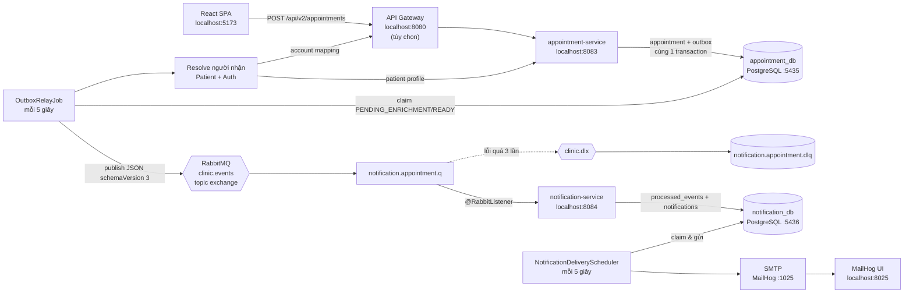
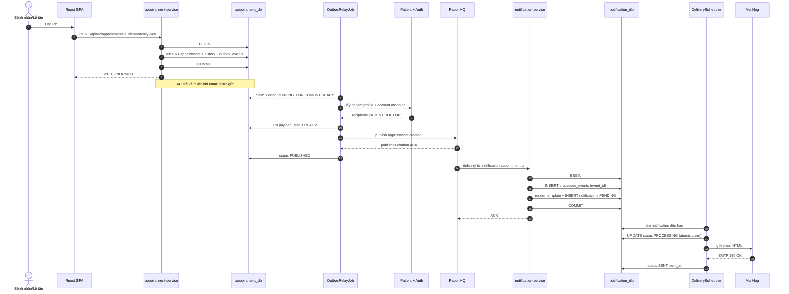

# Hệ thống thông báo FClinic — Kế hoạch, cơ chế và hướng dẫn vận hành

> Tài liệu này mô tả **hệ thống thông báo đang có trong code**, không phải thiết kế đề xuất.
> Đã đối chiếu với source code, cấu hình và môi trường local ngày **2026-11-10**.
> Phạm vi: appointment-service → RabbitMQ → notification-service → SMTP/MailHog, cùng API tra cứu và retry.

---

## 1. Mục tiêu và phạm vi

Hệ thống thông báo chịu trách nhiệm:

1. Phát sự kiện khi lịch hẹn được **tạo**, **hủy**, **đổi lịch** hoặc **sắp đến giờ**.
2. Chuyển sự kiện đó thành **email xác nhận/hủy/đổi lịch/nhắc lịch** cho bệnh nhân và bác sĩ.
3. Không làm chậm API đặt lịch nếu SMTP hoặc RabbitMQ chậm/hỏng.
4. Không mất sự kiện khi một service tạm thời không khả dụng.
5. Không gửi trùng email khi RabbitMQ redeliver hoặc consumer crash.
6. Cho phép tra cứu trạng thái và gửi lại email thất bại.

Ngoài phạm vi hiện tại:

- Chưa có SMS, push notification hay in-app notification.
- Chưa có gửi email cho người thân, lễ tân hoặc cơ sở y tế.
- Chưa có template đa ngôn ngữ; template hiện là tiếng Việt trong database.

---

## 2. Kiến trúc tổng thể



### Thành phần chính

| Thành phần | Vai trò | Công nghệ |
|---|---|---|
| `appointment-service` | Nguồn phát sự kiện lịch hẹn | Java 21, Spring Boot, PostgreSQL |
| `outbox_events` | Hàng đợi bền vững nội bộ của appointment-service | PostgreSQL, JSONB |
| `OutboxRelayJob` | Chuyển outbox → RabbitMQ | Spring `@Scheduled` |
| `clinic.events` | Exchange phân phối sự kiện | RabbitMQ topic exchange |
| `notification.appointment.q` | Queue chính của notification-service | RabbitMQ durable queue |
| `notification-service` | Validate, render template, tạo job gửi email | Java 21, Spring Boot, Thymeleaf |
| `notification_db` | Lưu job gửi, template, idempotency ledger | PostgreSQL |
| `SmtpEmailSender` | Gửi email HTML | Spring `JavaMailSender` |
| MailHog | SMTP sink và UI kiểm thử local | MailHog |
| `NotificationController` | Tra cứu và retry thủ công | Spring REST |

### Nguyên tắc thiết kế

- **Transactional Outbox**: appointment và outbox được ghi trong cùng transaction; không publish trực tiếp trong request.
- **At-least-once delivery**: RabbitMQ có thể giao lại; notification-service chống trùng bằng `processed_events`.
- **Two-phase notification**: Phase A chỉ ghi database và ACK nhanh; Phase B gửi SMTP ngoài transaction.
- **Fail closed**: event sai schema bị đẩy DLQ, không cố đoán dữ liệu.
- **Không dùng Redis** trong luồng thông báo. Redis chỉ liên quan đến các phần khác của hệ thống, không phải notification delivery.

---

## 3. Luồng end-to-end



### Điểm quan trọng

- API đặt lịch **không gửi email trực tiếp**. Nó chỉ ghi appointment + outbox.
- Outbox relay lấy **một event mỗi lần chạy**, mặc định mỗi 5 giây (`appointment.outbox-poll-ms`).
- Việc resolve người nhận xảy ra **trong lúc relay**, không phải lúc booking.
- Payload cuối được **đóng băng** trong `outbox_events.payload`; retry sau đó dùng lại payload này.
- Notification-service chỉ tạo job; scheduler gửi SMTP sau đó vài giây.

---

## 4. Cơ chế theo từng giai đoạn

### 4.1. Giai đoạn 1 — Booking tạo domain event

**Trigger**

```http
POST /api/v2/appointments
Authorization: Bearer <access-token>
Idempotency-Key: <uuid>
Content-Type: application/json

{
  "patientId": "999624ee-0cbb-47c6-9326-1efd55974622",
  "doctorId": "33333333-3333-4333-8333-333333333301",
  "slotId": "<slot-uuid>",
  "reasonForVisit": "..."
}
```

**Cơ chế**

1. Controller yêu cầu header `Idempotency-Key`.
2. Application service resolve patient, doctor, slot từ service khác.
3. Trong một transaction PostgreSQL:
   - insert `appointments`;
   - insert `appointment_history`;
   - insert `outbox_events` với `status = PENDING_ENRICHMENT`;
   - lưu `intent` JSON schemaVersion 3.
4. Transaction commit xong mới trả `201`.

**Vì sao dùng outbox**

Nếu ghi database thành công rồi publish RabbitMQ thất bại, email sẽ mất. Nếu publish trước rồi database rollback, email sẽ báo một lịch hẹn không tồn tại. Outbox đưa cả hai việc vào cùng transaction PostgreSQL, tránh dual-write và không cần distributed transaction.

**Vì sao không dùng Redis lock**

Phiên bản hiện tại dùng PostgreSQL partial unique index để chống trùng slot (`APPOINTMENT_LOCK_PROVIDER=postgres`). Notification không cần lock phân tán; outbox claim dùng `FOR UPDATE SKIP LOCKED`.

### 4.2. Giai đoạn 2 — Outbox relay và enrich người nhận

**Mã chính**

- `OutboxRelayJob` — chạy `relay()` mỗi 5 giây và `reminders()` mỗi 30 giây.
- `PublishOutboxService` — claim, enrich, publish, cập nhật trạng thái.
- `JdbcOutboxStoreAdapter` — SQL claim/ready/published/retry/suppress.
- `NotificationPayloadAdapter` — thêm `recipients` vào payload.
- `HttpAppointmentReferenceAdapter.recipients(...)` — gọi Patient và Auth.

**Claim SQL**

```sql
UPDATE outbox_events
SET claim_token = ?, claimed_until = ?, updated_at = ?
WHERE id IN (
  SELECT id
  FROM outbox_events
  WHERE status IN ('PENDING_ENRICHMENT', 'READY')
    AND (next_attempt_at IS NULL OR next_attempt_at <= ?)
    AND (claimed_until IS NULL OR claimed_until < ?)
  ORDER BY created_at, id
  FOR UPDATE SKIP LOCKED
  LIMIT 1
)
RETURNING *;
```

**Trạng thái outbox**

| Trạng thái | Ý nghĩa |
|---|---|
| `PENDING_ENRICHMENT` | Đã có intent, chưa resolve được người nhận |
| `READY` | Đã có payload đầy đủ, sẵn sàng publish |
| `PUBLISHED` | RabbitMQ đã confirm |
| `SUPPRESSED` | Reminder cũ, không còn hợp lệ |

**Enrich người nhận**

1. `GET /api/v3/patients/{patientId}` lấy `fullName`, `email` từ Patient-service.
2. `POST /api/v1/auth/internal/appointment-recipient-accounts` lấy:
   - `patientUserId` (có thể `null` nếu bệnh nhân walk-in chưa có tài khoản);
   - đúng một tài khoản bác sĩ `doctor.userId`, `doctor.name`, `doctor.email`.
3. Gắn danh sách `recipients` gồm đúng một `PATIENT` và một `DOCTOR` vào payload.

**Điều kiện tiên quyết**

- Bác sĩ phải có **đúng một** tài khoản Auth active, role `ROLE_DOCTOR`, và `doctor_id` khớp.
- Bệnh nhân có thể không có tài khoản; khi đó `patientUserId = null` và email lấy từ Patient profile.
- Nếu bác sĩ chưa được map tài khoản, `AppointmentRecipientService` trả `503`, outbox ghi `DEPENDENCY_UNAVAILABLE` và retry sau 30 giây.
- Endpoint mapping tài khoản là endpoint **chỉ dành cho service**, dùng Basic credential riêng (`appointment-recipient-accounts`) và header contract `appointment-recipient-accounts/1`; token người dùng không gọi được endpoint này.

**Ví dụ mapping hiện có**

| Doctor ID | Auth account | Email |
|---|---|---|
| `33333333-3333-4333-8333-333333333301` | `bs_an` | `doctor.an@fclinic.vn` |

Các bác sĩ còn lại trong directory chưa có mapping thì không thể nhận email.

### 4.3. Giai đoạn 3 — Publish RabbitMQ

**Routing key**

| Domain event | Routing key | Notification type |
|---|---|---|
| `APPOINTMENT_CREATED` | `appointment.created` | `APPOINTMENT_CONFIRMATION` |
| `APPOINTMENT_CANCELLED` | `appointment.cancelled` | `APPOINTMENT_CANCELLATION` |
| `APPOINTMENT_RESCHEDULED` | `appointment.rescheduled` | `APPOINTMENT_RESCHEDULED` |
| `APPOINTMENT_REMINDER` | `appointment.reminder` | `APPOINTMENT_REMINDER` |

**Cơ chế publish**

- Message body là JSON UTF-8 thô, không lồng thành string.
- `content_type = application/json`, `content_encoding = UTF-8`.
- `delivery_mode = 2` (persistent).
- `message_id = eventId`.
- `publisher-confirm-type: correlated` và `publisher-returns: true`.
- Nếu broker không ACK hoặc message bị return, outbox ghi `BROKER_UNAVAILABLE` và retry sau 30 giây.

**Vì sao dùng RabbitMQ topic exchange**

- Appointment-service không cần biết Notification-service đang chạy ở đâu.
- Có thể thêm consumer khác (audit, analytics) mà không sửa producer.
- Durable queue + persistent message giúp message sống qua restart broker.
- DLX/DLQ tách message lỗi khỏi luồng chính.

### 4.4. Giai đoạn 4 — Ingestion và chống trùng

**Mã chính**

- `AppointmentEventListener` — nhận message, không gửi SMTP.
- `NotificationIngestionService` — validate, render template, tạo job.
- `ThymeleafTemplateAdapter` — render subject/body.
- `ProcessedEventPort` — ledger chống trùng.

**Transaction ingestion**

```text
BEGIN
  nếu event_id đã có trong processed_events:
      COMMIT, bỏ qua
  INSERT processed_events(event_id, event_type, source, occurred_at, processed_at)
  INSERT notifications(PATIENT, PENDING) nếu có email
  INSERT notifications(DOCTOR, PENDING) nếu có email
COMMIT
```

Marker `processed_events` được insert **trước** các notification row. Nếu hai consumer xử lý cùng event, một bên sẽ vi phạm primary key; bên còn lại kiểm tra lại và bỏ qua. Nhờ vậy không tạo email trùng.

**Validate**

- `schemaVersion` phải bằng `3`.
- `source` phải bằng `appointment-service`.
- Nếu có `recipients`, phải đúng 2 phần tử: một `PATIENT`, một `DOCTOR`.
- Không được vừa có `patient`/`doctor` lồng nhau vừa có `recipients`.
- `doctor.userId` bắt buộc và phải là UUIDv4.
- `appointmentId` phải là UUIDv4.
- Nếu event là `APPOINTMENT_RESCHEDULED`, phải có `previousSlot`.

**Vì sao validate chặt**

Message sai schema không được đoán hoặc tự sửa, vì có thể gửi nhầm người hoặc nhầm lịch. Message sai bị đẩy DLQ để điều tra.

**Retry và DLQ**

- `spring.rabbitmq.listener.simple.retry.enabled = true`.
- `max-attempts = 3`, backoff `1s → 2s` (initial 1s, multiplier 2, tối đa 10s).
- `default-requeue-rejected = false`.
- Sau 3 lần lỗi, message bị reject và RabbitMQ chuyển qua `clinic.dlx` → `notification.appointment.dlq`.
- Message trong DLQ không tự retry; phải sửa nguyên nhân rồi publish lại hoặc move thủ công.
- Listener dùng `acknowledge-mode: auto`, `prefetch: 20`, `concurrency: 1`, `max-concurrency: 4`.

### 4.5. Giai đoạn 5 — Render template

- Template lưu trong bảng `notification_templates`, không nằm trong file.
- Mỗi cặp `(notification_type, recipient_type, channel=EMAIL)` có một template active.
- Subject render bằng `TemplateMode.TEXT`; body render bằng `TemplateMode.HTML`.
- Dùng `StringTemplateResolver`, tức là template được truyền trực tiếp từ database, không đọc file.
- Biến HTML được escape mặc định, giảm rủi ro XSS trong email.
- Subject được chuẩn hóa khoảng trắng liên tiếp thành một space.

**Biến template hiện có**

| Biến | Nguồn |
|---|---|
| `recipientName` | tên người nhận |
| `patientName` | Patient profile |
| `doctorName` | Auth mapping |
| `appointmentId` | event |
| `appointmentDate` | `dd/MM/yyyy` |
| `appointmentTime` | `HH:mm` |
| `appointmentEndTime` | `HH:mm` |
| `clinicName` | mặc định `FClinic` |
| `roomName` | hiện lấy từ `doctorSpecialty` trong fallback |
| `reason` | hiện thường rỗng |
| `cancellationReason` | hiện thường rỗng |
| `previousAppointmentDate` | chỉ event đổi lịch |
| `previousAppointmentTime` | chỉ event đổi lịch |

> **Giới hạn hiện tại:** payload sự kiện không chứa `reasonForVisit`, lý do hủy, `clinicName` hay `roomName` thật. Database outbox còn có CHECK cấm các trường tự do như `reason`, `diagnosis`, `notes`. Vì vậy template có thể hiển thị “Lý do khám” hoặc “Lý do hủy” rỗng. Đây là lựa chọn bảo vệ dữ liệu lâm sàng, không phải lỗi gửi mail.

### 4.6. Giai đoạn 6 — Gửi email

**Scheduler**

- `NotificationDeliveryScheduler` chạy mỗi 5 giây (`app.notification.delivery.scheduler-delay-ms`).
- Mỗi lần lấy tối đa 100 job đến hạn (`batch-size`).
- Job đến hạn là `PENDING` hoặc `RETRY_SCHEDULED` có `next_attempt_at <= now`.

**Claim nguyên tử**

```sql
UPDATE notifications
SET status = 'PROCESSING',
    last_attempt_at = :now,
    updated_at = :now,
    version = version + 1
WHERE id = :id
  AND status IN ('PENDING', 'RETRY_SCHEDULED');
```

Chỉ một worker UPDATE thành công. Không giữ row lock trong lúc gửi SMTP.

**Gửi**

- `SmtpEmailSender` dùng `MimeMessageHelper` với UTF-8.
- From lấy từ `MAIL_FROM_ADDRESS`, `MAIL_FROM_NAME`.
- Timeout kết nối/đọc/ghi đều 5 giây.
- Local dùng MailHog tại `localhost:1025`; xem mail tại `http://localhost:8025`.

**Kết quả**

| Kết quả | Trạng thái | Ghi chú |
|---|---|---|
| SMTP thành công | `SENT` | lưu `sent_at` |
| Lỗi lần 1 | `RETRY_SCHEDULED` | retry sau 1 phút |
| Lỗi lần 2 | `RETRY_SCHEDULED` | retry sau 5 phút |
| Lỗi lần 3 | `PERMANENT_FAILURE` | cần retry thủ công |
| Worker crash | `RETRY_SCHEDULED` | phục hồi sau 10 phút, không tăng attempt |

**Mã lỗi thường gặp**

- `SMTP_CONNECTION_ERROR`: MailHog/SMTP không chạy hoặc sai host/port.
- `SMTP_AUTH_ERROR`: sai username/password hoặc SMTP yêu cầu auth.
- `INVALID_RECIPIENT`: email không hợp lệ.
- `RECOVERED_STUCK_PROCESSING`: job bị treo và được phục hồi.
- `UNKNOWN_EMAIL_ERROR`: lỗi không phân loại.

### 4.7. Giai đoạn 7 — Phục hồi job treo

- `StuckNotificationRecoveryScheduler` chạy mỗi 60 giây.
- Tìm notification `PROCESSING` có `last_attempt_at < now - 10 phút`.
- Chuyển về `RETRY_SCHEDULED`, `next_attempt_at = now`, `last_error_code = RECOVERED_STUCK_PROCESSING`.
- Không tăng `attempt_count`, vì không biết SMTP đã gửi hay chưa. Đây là đánh đổi chấp nhận **at-least-once**; email hiếm khi bị gửi trùng nếu worker chết sau khi SMTP đã nhận.

### 4.8. Giai đoạn 8 — Tra cứu và retry thủ công

| Method | Endpoint | Quyền | Mục đích |
|---|---|---|---|
| `GET` | `/api/v1/notifications/me` | authenticated | danh sách notification của chính mình |
| `GET` | `/api/v1/notifications/{id}` | authenticated | chi tiết notification của chính mình |
| `GET` | `/api/v1/admin/notifications` | `ROLE_ADMIN` | tra cứu toàn bộ, lọc `status` |
| `GET` | `/api/v1/admin/notifications/{id}` | `ROLE_ADMIN` | chi tiết bất kỳ |
| `POST` | `/api/v1/admin/notifications/{id}/retry` | `ROLE_ADMIN` | reset job `PERMANENT_FAILURE` để gửi lại |

Retry thủ công:

- Chỉ áp dụng cho `PERMANENT_FAILURE`.
- Reset `attempt_count = 0`, `status = RETRY_SCHEDULED`, `next_attempt_at = now`.
- Không tạo event mới, không đổi `event_id`.

---

## 5. Ma trận trigger

| Nghiệp vụ | Cách trigger | Domain event | Notification type | Ai nhận | Thời điểm gửi |
|---|---|---|---|---|---|
| Đặt lịch | `POST /api/v2/appointments` | `APPOINTMENT_CREATED` | `APPOINTMENT_CONFIRMATION` | PATIENT + DOCTOR | sau relay + scheduler, thường 5–10 giây |
| Hủy lịch | `PUT /api/v2/appointments/{id}/cancel` | `APPOINTMENT_CANCELLED` | `APPOINTMENT_CANCELLATION` | PATIENT + DOCTOR | như trên |
| Đổi lịch | `PUT /api/v2/appointments/{id}/reschedule` | `APPOINTMENT_RESCHEDULED` | `APPOINTMENT_RESCHEDULED` | PATIENT + DOCTOR | như trên |
| Nhắc lịch | scheduler nội bộ appointment-service | `APPOINTMENT_REMINDER` | `APPOINTMENT_REMINDER` | PATIENT + DOCTOR | khi `start - reminderLead <= now` |
| Gửi lại | `POST /api/v1/admin/notifications/{id}/retry` | không có event mới | giữ nguyên | giữ nguyên | scheduler kế tiếp |
| Test trực tiếp | publish RabbitMQ | bất kỳ event hợp lệ | theo `eventType` | theo `recipients` | scheduler kế tiếp |

### Điều kiện cho reminder

Reminder **không bật mặc định**. Cần đặt:

```properties
appointment.reminder-lead=PT24H
```

hoặc biến môi trường:

```bash
APPOINTMENT_REMINDER_LEAD=PT24H
```

Sau đó restart appointment-service. Điều kiện tạo reminder:

- appointment `CONFIRMED`;
- `startInstant > now`;
- `startInstant - lead <= now`;
- chưa có bản ghi `reminder_publications` cho cùng `(appointment_id, aggregate_version, reminder_due_at)`.

Nếu appointment bị hủy/đổi lịch trước khi reminder được publish, relay sẽ thấy reminder không còn “current” và chuyển outbox sang `SUPPRESSED`.

---

## 6. Hợp đồng message

### 6.1. Payload schemaVersion 3

```json
{
  "eventId": "4b8f3d8e-7b8a-4f2e-9c1d-2a6f0b7c9d11",
  "eventType": "APPOINTMENT_CREATED",
  "schemaVersion": 3,
  "occurredAt": "2026-11-10T05:00:00Z",
  "source": "appointment-service",
  "appointmentId": "a14eecd4-4c0f-4d99-a26c-d89b3d5c646c",
  "aggregateVersion": 0,
  "bookingCode": "FC-802A985995AF4B8EBE2E231AEDCD1F82",
  "patientId": "999624ee-0cbb-47c6-9326-1efd55974622",
  "patientName": "user01",
  "patientPhone": "0900000000",
  "doctorId": "33333333-3333-4333-8333-333333333301",
  "doctorName": "BS. CKII Nguyễn Văn An",
  "doctorSpecialty": "Tim mạch",
  "slotId": "2aafdd6a-21c4-4035-a129-7724cc9b9447",
  "appointmentDate": "2026-11-10",
  "startTime": "14:00:00",
  "endTime": "15:00:00",
  "timezone": "Asia/Saigon",
  "recipients": [
    {
      "recipientType": "PATIENT",
      "userId": "a0b1c2d3-e4f5-4678-9abc-def012345678",
      "name": "user01",
      "email": "simplification02@gmail.com"
    },
    {
      "recipientType": "DOCTOR",
      "userId": "b1c2d3e4-f5a6-4789-abcd-ef0123456789",
      "name": "BS. CKII Nguyễn Văn An",
      "email": "doctor.an@fclinic.vn"
    }
  ]
}
```

Các trường bổ sung:

- `APPOINTMENT_RESCHEDULED`: thêm `previousSlotId`, `previousAppointmentDate`, `previousStartTime`, `previousEndTime`.
- `APPOINTMENT_REMINDER`: thêm `reminderDueAt`.

### 6.2. Vì sao event không có lý do khám

`V1__appointment_v2.sql` đặt CHECK cấm các khóa `reasonForVisit`, `reason`, `diagnosis`, `treatment`, `notes` trong `intent` và `payload`. Mục tiêu là không đưa nội dung lâm sàng tự do vào message broker và email. Vì vậy template phải chấp nhận các trường này rỗng.

---

## 7. Cấu hình local

### 7.1. Biến môi trường chính

| Biến | Mặc định | Ý nghĩa |
|---|---|---|
| `APPOINTMENT_OUTBOX_ENABLED` | `true` | bật relay outbox |
| `APPOINTMENT_OUTBOX_POLL_MS` | `5000` | chu kỳ relay |
| `APPOINTMENT_REMINDER_LEAD` | rỗng | tắt reminder nếu rỗng |
| `APPOINTMENT_REMINDER_POLL_MS` | `30000` | chu kỳ quét reminder |
| `APPOINTMENT_RECIPIENT_URL` | `http://localhost:8085/api/v1/auth/internal/appointment-recipient-accounts` | endpoint mapping tài khoản |
| `APPOINTMENT_PATIENT_TOKEN_CLIENT_ID` | `appointment-service` | client lấy token đọc Patient |
| `RABBITMQ_HOST` | `localhost` | broker host |
| `RABBITMQ_PORT` | `5672` | broker port |
| `MAIL_HOST` | `localhost` | SMTP host |
| `MAIL_PORT` | `1025` | SMTP port |
| `MAIL_FROM_ADDRESS` | `no-reply@fclinic.local` | địa chỉ gửi |
| `MAIL_FROM_NAME` | `FClinic` | tên hiển thị |
| `DELIVERY_SCHEDULER_DELAY_MS` | `5000` | chu kỳ gửi |
| `DELIVERY_BATCH_SIZE` | `100` | số job mỗi lần |
| `DELIVERY_MAX_ATTEMPTS` | `3` | số lần thử tối đa |
| `DELIVERY_PROCESSING_TIMEOUT` | `10m` | timeout job treo |

### 7.2. Cấu hình quan trọng

`ClinicAppointmentBE/services/appointment-service/src/main/resources/application.yml`:

```yaml
appointment:
  outbox-enabled: ${APPOINTMENT_OUTBOX_ENABLED:true}
  reminder-lead: ${APPOINTMENT_REMINDER_LEAD:}
  outbox-poll-ms: ${APPOINTMENT_OUTBOX_POLL_MS:5000}
  reminder-poll-ms: ${APPOINTMENT_REMINDER_POLL_MS:30000}
```

`ClinicAppointmentBE/services/notification-service/src/main/resources/application.yml`:

```yaml
app:
  notification:
    delivery:
      scheduler-delay-ms: ${DELIVERY_SCHEDULER_DELAY_MS:5000}
      batch-size: ${DELIVERY_BATCH_SIZE:100}
      max-attempts: ${DELIVERY_MAX_ATTEMPTS:3}
      processing-timeout: ${DELIVERY_PROCESSING_TIMEOUT:10m}
      retry-delays:
        - 1m
        - 5m
```

---

## 8. Cách trigger và kiểm thử

### 8.1. Trigger end-to-end bằng API

**Bước 1 — đăng nhập**

```bash
BASE=http://localhost:8080
read -rsp "Password: " PASSWORD
TOKEN=$(curl -s -X POST "$BASE/api/v1/auth/login" \
  -H 'Content-Type: application/json' \
  -d "{\"username\":\"user01\",\"password\":\"$PASSWORD\"}" \
  | jq -r '.data.accessToken')
```

Có thể gọi trực tiếp appointment-service `http://localhost:8083` nếu không chạy Gateway.

**Bước 2 — tìm slot**

```bash
curl -s "$BASE/api/v2/appointments/available-slots?doctorId=33333333-3333-4333-8333-333333333301&date=2026-11-10" \
  -H "Authorization: Bearer $TOKEN" | jq
```

Chọn slot có `"available": true`.

**Bước 3 — đặt lịch**

```bash
IDEMPOTENCY_KEY=$(uuidgen)
curl -s -X POST "$BASE/api/v2/appointments" \
  -H "Authorization: Bearer $TOKEN" \
  -H "Idempotency-Key: $IDEMPOTENCY_KEY" \
  -H 'Content-Type: application/json' \
  -d '{
    "patientId":"999624ee-0cbb-47c6-9326-1efd55974622",
    "doctorId":"33333333-3333-4333-8333-333333333301",
    "slotId":"<slot-uuid>",
    "reasonForVisit":"Kiểm thử hệ thống thông báo"
  }' | jq
```

Kỳ vọng: `201`, `status: CONFIRMED`, có `id` và `bookingCode`.

**Bước 4 — kiểm tra outbox**

```bash
docker exec fclinic-postgres-appointment sh -c \
 'psql -U "$POSTGRES_USER" -d "$POSTGRES_DB" -P pager=off -c \
 "SELECT id,event_type,status,attempt_count,last_error_code,published_at
  FROM outbox_events ORDER BY created_at DESC LIMIT 10;"'
```

Kỳ vọng: event `APPOINTMENT_CREATED` chuyển `PUBLISHED`, `last_error_code` rỗng.

**Bước 5 — kiểm tra notification**

```bash
docker exec fclinic-postgres-notification sh -c \
 'psql -U "$POSTGRES_USER" -d "$POSTGRES_DB" -P pager=off -c \
 "SELECT id,appointment_id,recipient_type,notification_type,status,
         attempt_count,last_error_code,sent_at
  FROM notifications ORDER BY created_at DESC LIMIT 10;"'
```

Kỳ vọng: hai dòng `PATIENT` và `DOCTOR`, `status = SENT`.

**Bước 6 — xem mail**

```bash
curl -s http://localhost:8025/api/v2/messages | jq '.items | length'
```

Mở `http://localhost:8025` để xem nội dung.

### 8.2. Trigger hủy lịch

```bash
APPOINTMENT_ID=<appointment-uuid>
VERSION=0
curl -s -X PUT "$BASE/api/v2/appointments/$APPOINTMENT_ID/cancel" \
  -H "Authorization: Bearer $TOKEN" \
  -H "Idempotency-Key: $(uuidgen)" \
  -H 'Content-Type: application/json' \
  -d "{\"version\":$VERSION,\"reason\":\"Bệnh nhân bận\"}" | jq
```

Kỳ vọng: `200`, `status: CANCELLED`; phát sinh event `APPOINTMENT_CANCELLED` và email hủy.

### 8.3. Trigger đổi lịch

```bash
APPOINTMENT_ID=<appointment-uuid>
VERSION=0
curl -s -X PUT "$BASE/api/v2/appointments/$APPOINTMENT_ID/reschedule" \
  -H "Authorization: Bearer $TOKEN" \
  -H "Idempotency-Key: $(uuidgen)" \
  -H 'Content-Type: application/json' \
  -d "{\"version\":$VERSION,\"slotId\":\"<new-slot-uuid>\",\"reason\":\"Đổi giờ\"}" | jq
```

Kỳ vọng: `200`, `status: CONFIRMED`; event `APPOINTMENT_RESCHEDULED` có `previousSlot...`; email hiển thị giờ cũ/mới.

### 8.4. Trigger reminder

```bash
# 1. Bật lead 24 giờ trong .env
APPOINTMENT_REMINDER_LEAD=PT24H

# 2. Restart appointment-service

# 3. Tạo appointment có startTime > now và nằm trong 24 giờ
# 4. Chờ tối đa 30 giây

docker exec fclinic-postgres-appointment sh -c \
 'psql -U "$POSTGRES_USER" -d "$POSTGRES_DB" -P pager=off -c \
 "SELECT id,event_type,status,last_error_code
  FROM outbox_events WHERE event_type='\''APPOINTMENT_REMINDER'\''
  ORDER BY created_at DESC LIMIT 5;"'
```

### 8.5. Publish trực tiếp để test notification-service

Chỉ dùng khi muốn test ingestion/delivery mà không qua booking. Cách này bỏ qua outbox và bước enrich của appointment-service, nên payload phải có `recipients` đầy đủ.

```bash
RABBIT_USER=fclinic_rabbit
RABBIT_PASS=<rabbit-password>
cat >/tmp/notification-event.json <<'JSON'
{
  "eventId": "4b8f3d8e-7b8a-4f2e-9c1d-2a6f0b7c9d11",
  "eventType": "APPOINTMENT_CREATED",
  "schemaVersion": 3,
  "occurredAt": "2026-11-10T05:00:00Z",
  "source": "appointment-service",
  "appointmentId": "a14eecd4-4c0f-4d99-a26c-d89b3d5c646c",
  "aggregateVersion": 0,
  "bookingCode": "FC-TEST-001",
  "patientId": "999624ee-0cbb-47c6-9326-1efd55974622",
  "patientName": "user01",
  "patientPhone": "0900000000",
  "doctorId": "33333333-3333-4333-8333-333333333301",
  "doctorName": "BS. CKII Nguyễn Văn An",
  "doctorSpecialty": "Tim mạch",
  "slotId": "2aafdd6a-21c4-4035-a129-7724cc9b9447",
  "appointmentDate": "2026-11-10",
  "startTime": "14:00:00",
  "endTime": "15:00:00",
  "timezone": "Asia/Saigon",
  "recipients": [
    {"recipientType":"PATIENT","userId":"a0b1c2d3-e4f5-4678-9abc-def012345678","name":"user01","email":"simplification02@gmail.com"},
    {"recipientType":"DOCTOR","userId":"b1c2d3e4-f5a6-4789-abcd-ef0123456789","name":"BS. CKII Nguyễn Văn An","email":"doctor.an@fclinic.vn"}
  ]
}
JSON

PAYLOAD=$(jq -Rs . </tmp/notification-event.json)
curl -s -u "$RABBIT_USER:$RABBIT_PASS" \
  -H 'Content-Type: application/json' \
  -X POST http://localhost:15672/api/exchanges/%2F/clinic.events/publish \
  -d "{\"properties\":{\"delivery_mode\":2,\"content_type\":\"application/json\",\"content_encoding\":\"UTF-8\",\"message_id\":\"$(uuidgen)\"},\"routing_key\":\"appointment.created\",\"payload\":$PAYLOAD,\"payload_encoding\":\"string\"}" | jq
```

Lưu ý: UUID trong payload phải là UUIDv4; `doctor.userId` không được null; `recipients` phải đúng một PATIENT và một DOCTOR.

---

## 9. Kiểm tra, giám sát và xử lý sự cố

### 9.1. Lệnh kiểm tra nhanh

```bash
# Service health
curl -s http://localhost:8081/actuator/health | jq
curl -s http://localhost:8083/actuator/health | jq
curl -s http://localhost:8084/actuator/health | jq

# RabbitMQ queue
docker exec fclinic-rabbitmq rabbitmqctl list_queues name messages consumers

# Outbox gần nhất
docker exec fclinic-postgres-appointment sh -c \
 'psql -U "$POSTGRES_USER" -d "$POSTGRES_DB" -P pager=off -c \
 "SELECT event_type,status,attempt_count,last_error_code,next_attempt_at,
         created_at,published_at
  FROM outbox_events ORDER BY created_at DESC LIMIT 20;"'

# Notification gần nhất
docker exec fclinic-postgres-notification sh -c \
 'psql -U "$POSTGRES_USER" -d "$POSTGRES_DB" -P pager=off -c \
 "SELECT notification_type,recipient_type,status,attempt_count,
         last_error_code,next_attempt_at,sent_at
  FROM notifications ORDER BY created_at DESC LIMIT 20;"'
```

### 9.2. Bảng chẩn đoán

| Triệu chứng | Nguyên nhân thường gặp | Cách xử lý |
|---|---|---|
| Outbox `PENDING_ENRICHMENT`, `DEPENDENCY_UNAVAILABLE` | Patient lookup lỗi hoặc bác sĩ chưa có mapping Auth | Kiểm tra token `appointment-service`, role `SVC_PATIENT_READ`, mapping `doctor_id` trong Auth |
| Outbox `READY`/`PENDING_ENRICHMENT`, `BROKER_UNAVAILABLE` | RabbitMQ down, sai credential, exchange/queue không tồn tại | Kiểm tra `docker compose ps`, `rabbitmqctl`, log appointment-service |
| Queue `notification.appointment.q` tăng, consumer = 0 | notification-service down hoặc listener lỗi | Kiểm tra health 8084, log `AppointmentEventListener` |
| Message nằm trong `notification.appointment.dlq` | Payload sai schema, thiếu UUID, sai recipients, lỗi sau 3 lần retry | Đọc message, đối chiếu contract, sửa producer rồi publish lại cùng `eventId` |
| Không tạo được notification, message vào DLQ | Thiếu template active hoặc template sai cặp type/recipient | Kiểm tra `notification_templates` với `notification_type`, `recipient_type='PATIENT'/'DOCTOR'`, `channel='EMAIL'`, `active=true` |
| Notification `PERMANENT_FAILURE`, `SMTP_CONNECTION_ERROR` | MailHog/SMTP down hoặc sai host/port | Bật MailHog, kiểm tra `MAIL_HOST`, `MAIL_PORT`; retry qua API |
| Notification `PERMANENT_FAILURE`, `SMTP_AUTH_ERROR` | Sai `MAIL_USERNAME`/`MAIL_PASSWORD` | Sửa cấu hình SMTP; retry |
| Notification `PROCESSING` quá lâu | Worker crash giữa lúc gửi | Chờ recovery 10 phút hoặc restart notification-service |
| Không có reminder | `APPOINTMENT_REMINDER_LEAD` rỗng | Đặt `PT24H`/`PT1H`, restart appointment-service |
| Email có “Lý do khám” rỗng | Payload cố ý không chứa lý do khám | Chấp nhận hoặc bổ sung contract có kiểm soát |
| Email có “Phòng” là chuyên khoa | Fallback `appointment()` dùng `doctorSpecialty` làm `roomName` | Bổ sung `roomName` thật vào contract nếu cần |

### 9.3. Metrics và log

Metrics Micrometer:

- `notification.events.ingested`
- `notification.events.duplicate`
- `notification.delivery.sent`
- `notification.delivery.retry`
- `notification.delivery.permanent_failure`
- `notification.delivery.recovered_stuck`

Log có cấu trúc:

- `event_ingested eventId=... appointmentId=...`
- `duplicate_event_ignored eventId=...`
- `notification_created notificationId=... eventId=...`
- `delivery_started notificationId=...`
- `delivery_sent notificationId=...`
- `delivery_retry notificationId=... nextAttemptAt=...`
- `delivery_permanent_failure notificationId=...`

---

## 10. Hiện trạng local và các điểm cần lưu ý

### 10.1. Hiện trạng đã kiểm chứng

- Auth, Patient, Appointment, Notification đều healthy.
- Đặt lịch qua frontend proxy trả `201`.
- Outbox event `APPOINTMENT_CREATED` chuyển `PUBLISHED`.
- Notification-service tạo hai job `PATIENT` và `DOCTOR`, cả hai `SENT`.
- MailHog nhận đủ email xác nhận và email hủy.
- Hủy lịch trả `200`, tạo email hủy cho cả hai phía.

### 10.2. Queue legacy đang tồn đọng

Appointment-service vẫn khai báo queue `fclinic.appointment.notifications` và bind 4 routing key, nhưng **không có consumer** cho queue này. Notification-service dùng queue `notification.appointment.q`.

Hệ quả:

- Mọi event được nhân bản sang queue legacy.
- Message tích tụ vô hạn, tốn disk.
- Không ảnh hưởng luồng chính vì queue đó không được đọc.

Kiểm tra:

```bash
docker exec fclinic-rabbitmq rabbitmqctl list_queues name messages consumers | grep fclinic.appointment
```

Khuyến nghị:

1. Xác nhận không còn consumer/dashboard nào đọc `fclinic.appointment.notifications`.
2. Xóa declaration queue/binding trong `appointment-service` `RabbitMQConfig`.
3. Sau khi đối soát, xóa queue legacy trên broker.
4. Không xóa nếu chưa kiểm tra, vì có thể còn message cần điều tra.

### 10.3. Giới hạn contract hiện tại

- Không có `reason`, `cancellationReason`, `clinicName`, `roomName` thật trong payload.
- `roomName` trong fallback đang là `doctorSpecialty`.
- Chỉ gửi email; chưa có SMS/push.
- Reminder mặc định tắt.
- Bác sĩ chưa có Auth mapping sẽ làm outbox retry vô hạn, không gửi được thông báo.
- Outbox relay chỉ claim 1 event mỗi 5 giây; throughput khoảng 12 event/phút. Với tải cao cần tăng batch hoặc giảm poll.
- Không có cơ chế dead-letter cho outbox; event lỗi dependency sẽ retry mãi. Cần giám sát `attempt_count` và `last_error_code`.

---

## 11. Checklist trước khi coi là “chạy được”

- [ ] `appointment-service` health UP.
- [ ] `notification-service` health UP.
- [ ] RabbitMQ có exchange `clinic.events`, queue `notification.appointment.q` có consumer.
- [ ] `notification.appointment.dlq` không tăng bất thường.
- [ ] Patient lookup bằng token `appointment-service` trả `200`.
- [ ] Bác sĩ được đặt lịch có đúng một tài khoản Auth active.
- [ ] Bệnh nhân có email hợp lệ trong Patient profile.
- [ ] `outbox_events` chuyển `PUBLISHED`.
- [ ] `processed_events` có `event_id`.
- [ ] `notifications` có đúng hai dòng `PATIENT`/`DOCTOR`.
- [ ] Trạng thái cuối là `SENT`, `sent_at` có giá trị.
- [ ] MailHog nhận đúng subject và người nhận.
- [ ] Nếu bật reminder: `APPOINTMENT_REMINDER_LEAD` có giá trị và `reminder_publications` có bản ghi.

---

## 12. Công nghệ nào dùng ở đâu và vì sao

| Công nghệ / pattern | Dùng ở giai đoạn | Lý do chọn | Đánh đổi |
|---|---|---|---|
| PostgreSQL + `outbox_events` | Booking, cancel, reschedule, reminder | Ghi appointment và event trong cùng transaction; tránh dual-write; JSONB lưu payload; UUIDv4 | Cần job relay và giám sát outbox |
| `FOR UPDATE SKIP LOCKED` | Outbox relay | Nhiều instance cùng poll mà không tranh một row; không cần lock phân tán | Mỗi lần chỉ claim 1 row, throughput thấp |
| RabbitMQ topic exchange | Publish và route sự kiện | Decouple producer/consumer; durable queue; routing key rõ ràng; publisher confirm | Có thể giao trùng, cần idempotency |
| Publisher confirm + return | Outbox publish | Chỉ đánh dấu `PUBLISHED` khi broker đã nhận và route được | Tăng độ trễ publish; cần xử lý timeout |
| Dead Letter Exchange/Queue | Message lỗi schema | Không để poison message chặn queue; giữ message để điều tra | Cần vận hành DLQ, không tự retry |
| Transactional Outbox + retry | Outbox | Không mất event khi broker/service tạm hỏng | Retry vô hạn nếu cấu hình sai, cần alert |
| `processed_events` + unique key | Ingestion | Chống gửi trùng khi Rabbit redeliver hoặc consumer crash | Tốn thêm bảng và transaction |
| Phase A / Phase B | Notification-service | ACK Rabbit nhanh; SMTP chậm không làm nghẽn queue | Email đến trễ vài giây |
| Atomic `UPDATE ... WHERE status IN (...)` | Delivery claim | Nhiều worker không gửi trùng cùng một job | Nếu worker chết sau SMTP, có thể gửi lại |
| `@Scheduled` fixedDelay | Outbox relay, reminder, delivery, recovery | Đơn giản, không cần scheduler ngoài; phù hợp local/small scale | Không scale ngang hoàn hảo; cần claim nguyên tử |
| Thymeleaf + DB template | Render email | Sửa nội dung không cần deploy; HTML an toàn; hỗ trợ tiếng Việt | Template nằm trong DB, cần migration/quản trị |
| `StringTemplateResolver` | Render template | Template lấy trực tiếp từ cột `body_template`, không cần file | Không có hot reload file |
| Spring `JavaMailSender` | Gửi email | Tích hợp sẵn, MIME UTF-8, timeout cấu hình được | Phụ thuộc SMTP; lỗi mạng phải retry |
| MailHog | Local SMTP | Bắt toàn bộ email local, xem UI/API, không gửi ra ngoài | Không dùng cho production |
| UUIDv4 | Event, appointment, recipient | Không lộ thứ tự; phù hợp microservice; validate chặt | Cần kiểm tra version/variant |
| Auth recipient mapping | Enrich người nhận | Không suy đoán tài khoản từ email/phone; bác sĩ phải có mapping chính xác | Bác sĩ chưa map sẽ chặn thông báo |
| Patient profile lookup | Lấy tên/email bệnh nhân | Patient-service là nguồn dữ liệu bệnh nhân | Phụ thuộc token/service; lỗi làm outbox retry |
| REST query/admin API | Tra cứu, retry | Tách vận hành khỏi luồng gửi; phân quyền rõ | Không dùng để trigger gửi trực tiếp |

**Không dùng Redis trong luồng này.** Redis không tham gia outbox, RabbitMQ, ingestion hay SMTP. Việc chống trùng slot dùng PostgreSQL; việc chống trùng email dùng `processed_events`.

---

## 13. Tóm tắt một câu

FClinic dùng **transactional outbox + RabbitMQ + hai pha ingestion/delivery** để biến thao tác lịch hẹn thành email bất đồng bộ, bền vững và chống trùng; appointment-service chỉ ghi database và phát sự kiện, notification-service render template và gửi SMTP qua scheduler, còn API REST chỉ dùng để tra cứu và retry.
