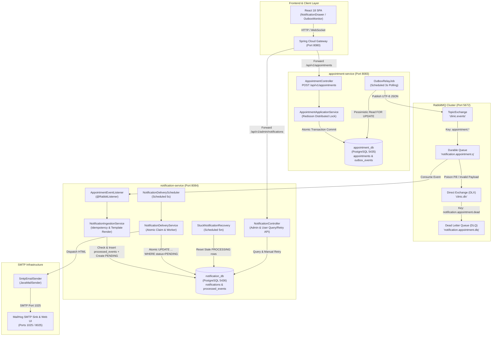
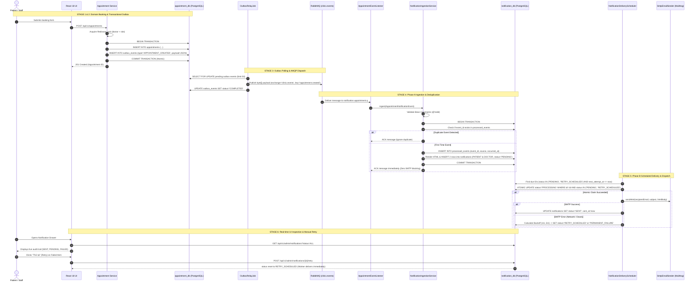
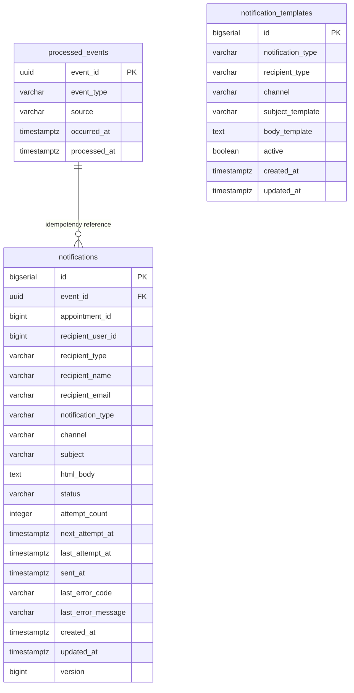
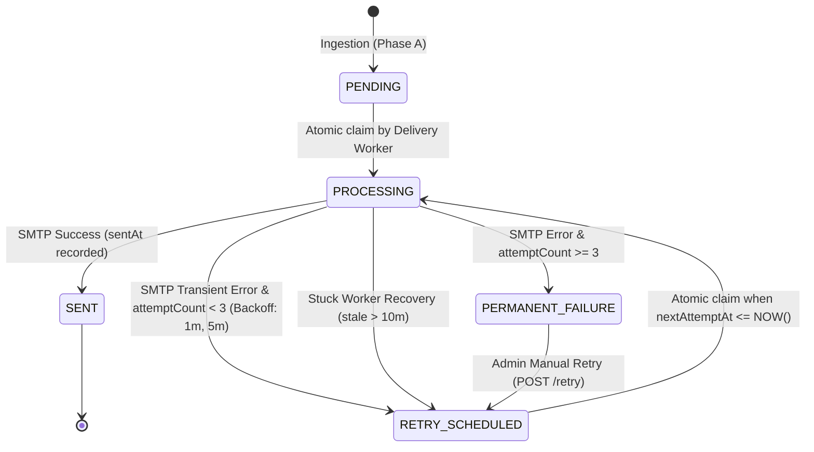
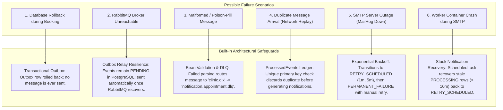

# FClinic Notification Subsystem: End-to-End Architecture & Technical Deep-Dive

This document provides a comprehensive technical breakdown of the **Notification Subsystem** in the **FClinic Enterprise Healthcare Management Platform**. It details how domain events are originated, reliably published, routed, ingested, rendered, delivered via SMTP, tracked, and managed across the microservices ecosystem.

---

## 1. High-Level Architectural Overview

The notification subsystem is architected around the **Event-Driven Architecture (EDA)**, **Transactional Outbox Pattern**, and **Two-Phase Async Delivery Pipeline (Phase A Ingestion & Phase B Delivery)**. This ensures zero data loss, strict idempotency, decoupled microservice lifecycles, and zero impact on end-user HTTP response times.



---

## 2. End-to-End Workflow & Event Lifecycle

The lifecycle of a clinical notification spans **7 discrete, highly decoupled stages**:



### Detailed Stage Breakdown

#### Stage 1: Domain Execution & Distributed Locking
- The booking request enters [`AppointmentApplicationService.bookAppointment`](file:///media/simpi/program-files/Program%20Files/Documents/Study/Code/MSS301/FClinic/ClinicAppointmentBE/services/appointment-service/src/main/java/com/fclinic/appointmentservice/application/usecase/AppointmentApplicationService.java).
- A **Redisson distributed lock** (`lock:doctor:{doctorId}:slot:{slotId}`) is acquired with a 5-second wait time and 10-second lease time. This prevents race conditions and slot double-booking across concurrent service instances.
- Business rules are validated (doctor schedule validity, slot availability, patient active status).

#### Stage 2: Transactional Outbox Atomic Commit
- Directly addressing the **Dual-Write Problem**: Writing to a database and publishing to a message broker cannot be joined in a single ACID transaction without inefficient distributed 2PC (Two-Phase Commit).
- Within the local PostgreSQL database transaction:
  1. The appointment record is created in `appointments`.
  2. The domain event [`AppointmentBookedDomainEvent`](file:///media/simpi/program-files/Program%20Files/Documents/Study/Code/MSS301/FClinic/ClinicAppointmentBE/services/appointment-service/src/main/java/com/fclinic/appointmentservice/domain/event/AppointmentBookedDomainEvent.java) is translated into [`AppointmentNotificationPayload`](file:///media/simpi/program-files/Program%20Files/Documents/Study/Code/MSS301/FClinic/ClinicAppointmentBE/services/appointment-service/src/main/java/com/fclinic/appointmentservice/infrastructure/messaging/dto/AppointmentNotificationPayload.java).
  3. The record is inserted into `outbox_events` with status `PENDING`.
- If the database rolls back, no message is ever sent. If the broker is offline, the transaction still succeeds and the event remains safely persisted in PostgreSQL.

#### Stage 3: Outbox Relay Job (Asynchronous Dispatch)
- [`OutboxRelayJob`](file:///media/simpi/program-files/Program%20Files/Documents/Study/Code/MSS301/FClinic/ClinicAppointmentBE/services/appointment-service/src/main/java/com/fclinic/appointmentservice/infrastructure/adapter/OutboxRelayJob.java) polls the `outbox_events` table every 3,000 ms using a pessimistic batch query:
  ```sql
  SELECT * FROM outbox_events WHERE status = 'PENDING' ORDER BY created_at ASC LIMIT 50 FOR UPDATE SKIP LOCKED
  ```
- It maps the event type to an explicit routing key:
  - `APPOINTMENT_CREATED` $\rightarrow$ `appointment.created`
  - `APPOINTMENT_CANCELLED` $\rightarrow$ `appointment.cancelled`
  - `APPOINTMENT_RESCHEDULED` $\rightarrow$ `appointment.rescheduled`
  - `APPOINTMENT_REMINDER` $\rightarrow$ `appointment.reminder`
- The payload is serialized into raw UTF-8 bytes and published using Spring `RabbitTemplate`:
  ```java
  Message message = MessageBuilder
          .withBody(event.getPayload().getBytes(StandardCharsets.UTF_8))
          .setContentType(MessageProperties.CONTENT_TYPE_JSON)
          .setContentEncoding(StandardCharsets.UTF_8.name())
          .build();
  rabbitTemplate.send(exchange, routingKey, message);
  ```
  *(Crucial Architectural Fix: Sending raw bytes with `CONTENT_TYPE_JSON` avoids Jackson double-escaping strings into `""{...}""`)*.
- Once broker receipt is confirmed, the outbox record transitions to `COMPLETED`.

#### Stage 4: Phase A Ingestion & Deduplication
- [`AppointmentEventListener`](file:///media/simpi/program-files/Program%20Files/Documents/Study/Code/MSS301/FClinic/ClinicAppointmentBE/services/notification-service/src/main/java/com/fclinic/notificationservice/infrastructure/messaging/AppointmentEventListener.java) receives the message from `notification.appointment.q`.
- **Constraint Validation**: Executes Jakarta Bean Validation (`@Valid`). If fields are malformed (e.g. invalid UUID, empty email, missing dates), it throws [`InvalidNotificationEventException`](file:///media/simpi/program-files/Program%20Files/Documents/Study/Code/MSS301/FClinic/ClinicAppointmentBE/services/notification-service/src/main/java/com/fclinic/notificationservice/application/exception/InvalidNotificationEventException.java). The listener retries 3 times, after which Spring AMQP routes the message directly to `clinic.dlx` $\rightarrow$ `notification.appointment.dlq`.
- **Idempotency Guard**:
  ```java
  if (processedEventPort.exists(event.eventId())) {
      log.warn("duplicate_event_ignored eventId={}", event.eventId());
      return; // Acknowledged cleanly, no duplicates created
  }
  ```
- **Template Rendering**: [`ThymeleafTemplateAdapter`](file:///media/simpi/program-files/Program%20Files/Documents/Study/Code/MSS301/FClinic/ClinicAppointmentBE/services/notification-service/src/main/java/com/fclinic/notificationservice/infrastructure/adapter/ThymeleafTemplateAdapter.java) fetches active templates from `notification_templates` and injects localized variables (`patientName`, `doctorName`, `appointmentDate`, `appointmentTime`, `clinicName`, `roomName`).
- **Atomic Creation**: Inserts 1 row into `processed_events` and 2 separate rows into `notifications` (one for `RecipientType.PATIENT`, one for `RecipientType.DOCTOR`) with `status = PENDING`.
- **Immediate Broker ACK**: The RabbitMQ transaction commits and ACKs immediately. The queue stays completely free of slow network I/O.

#### Stage 5: Phase B Scheduled Delivery & Delivery Backoff
- [`NotificationDeliveryScheduler`](file:///media/simpi/program-files/Program%20Files/Documents/Study/Code/MSS301/FClinic/ClinicAppointmentBE/services/notification-service/src/main/java/com/fclinic/notificationservice/infrastructure/scheduler/NotificationDeliveryScheduler.java) fires every 5,000 ms.
- Queries up to 100 due IDs where `status IN ('PENDING', 'RETRY_SCHEDULED') AND next_attempt_at <= NOW()`.
- **Lock-Free Atomic Claiming**:
  ```sql
  UPDATE notifications
     SET status = 'PROCESSING',
         last_attempt_at = :now,
         updated_at = :now,
         version = version + 1
   WHERE id = :id AND status IN ('PENDING', 'RETRY_SCHEDULED');
  ```
  If another concurrent scheduler thread or node claims it first, the update affects 0 rows and the thread skips it. No database row locks are held during the subsequent email transmission.
- **SMTP Transmission**: [`SmtpEmailSender`](file:///media/simpi/program-files/Program%20Files/Documents/Study/Code/MSS301/FClinic/ClinicAppointmentBE/services/notification-service/src/main/java/com/fclinic/notificationservice/infrastructure/mail/SmtpEmailSender.java) invokes Spring `JavaMailSender.send(...)` with a 5-second socket connection and read timeout.
- **Outcome Handling**:
  - **Success**: Status updated to `SENT`, `sent_at = NOW()`, `next_attempt_at = NULL`.
  - **Failure (Attempt 1 or 2)**: Next attempt scheduled with exponential backoff (`+1m`, then `+5m`), status set to `RETRY_SCHEDULED`, `attempt_count` incremented.
  - **Permanent Failure (Attempt $\ge$ 3)**: Status set to `PERMANENT_FAILURE`, `next_attempt_at = NULL`. Alert metrics incremented.

#### Stage 6: Self-Healing & Stuck Recovery
- If a container or JVM crashes in the middle of SMTP transmission, a record might remain stuck in `PROCESSING` forever.
- [`StuckNotificationRecoveryScheduler`](file:///media/simpi/program-files/Program%20Files/Documents/Study/Code/MSS301/FClinic/ClinicAppointmentBE/services/notification-service/src/main/java/com/fclinic/notificationservice/infrastructure/scheduler/StuckNotificationRecoveryScheduler.java) runs every 5 minutes:
  - Queries records with `status = 'PROCESSING'` and `last_attempt_at < NOW() - 10 minutes`.
  - Resets them to `RETRY_SCHEDULED` with `next_attempt_at = NOW()` and `last_error_code = 'RECOVERED_STUCK_PROCESSING'`.
  - It does **not** increment `attempt_count`, ensuring workers that crash do not penalize the retry budget.

#### Stage 7: Administrative Visibility & Manual Intervention
- Front-desk staff or administrators view delivery metrics and real-time status in [`NotificationDrawer.jsx`](file:///media/simpi/program-files/Program%20Files/Documents/Study/Code/MSS301/FClinic/ClinicAppointmentFE/src/components/NotificationDrawer.jsx) and [`OutboxMonitorPage.jsx`](file:///media/simpi/program-files/Program%20Files/Documents/Study/Code/MSS301/FClinic/ClinicAppointmentFE/src/pages/OutboxMonitorPage.jsx).
- For notifications marked `PERMANENT_FAILURE` (e.g., mail server was down for extended maintenance or invalid address corrected), the user clicks **"Thử lại"**.
- Hits `POST /api/v1/admin/notifications/{id}/retry`.
- The notification's attempt count is reset to 0, status reset to `RETRY_SCHEDULED`, and scheduled for immediate processing.

---

## 3. Technology Stack Breakdown & Justifications

| Technology | Role in Notification System | Why This Technology? (Architectural Justification) |
| :--- | :--- | :--- |
| **Java 21 LTS & Spring Boot 3.4** | Core Microservice Framework | Modern LTS features (virtual threads ready, switch pattern matching, record types), enterprise dependency injection, mature ecosystem, Spring Data JPA, and actuator metrics. |
| **Hexagonal / Clean Architecture** | Structural Code Organization | Decouples core notification domain (`Notification.java`, `DeliveryResult.java`) from external infrastructure (AMQP, SMTP, PostgreSQL). Allows swapping delivery providers or test mocks with zero core domain edits. |
| **RabbitMQ 3.13 (AMQP 0-9-1)** | Asynchronous Message Broker | **Topic Exchange** allows wildcard pattern routing (`appointment.*`). Durable queues survive broker restarts. Native Dead Letter Exchanges (`x-dead-letter-exchange`) guarantee failed messages are never dropped silently. Prefetch control (`prefetch=20`) prevents worker starvation. |
| **PostgreSQL 16** | Relational Event Store & Audit Log | ACID compliant. Native JSONB and UUID support. Provides atomic conditional row updates (`WHERE status IN (...)`) and row locking (`FOR UPDATE SKIP LOCKED`) essential for transactional outbox and worker claiming. |
| **Flyway** | Database Migration & Version Control | Version-controlled, reproducible database migrations (`V1__create_notification_tables.sql`, `V2__create_indexes.sql`, `V3__seed_notification_templates.sql`). Prevents drift between local, staging, and production environments. |
| **Thymeleaf** | Dynamic HTML Template Engine | Produces clean, standards-compliant HTML emails with natural templating syntax. Decouples localized Vietnamese clinical text from Java code. Templates are stored in PostgreSQL and rendered dynamically at runtime. |
| **JavaMailSender (Jakarta Mail)** | Email Dispatch Engine | Native Spring integration for MIME multi-part messages with UTF-8 support. Configured with strict network timeouts (5s connection timeout, 5s socket timeout) to prevent thread exhaustion during network degradation. |
| **MailHog** | Developer SMTP Sink & Web Viewer | Lightweight, containerized SMTP server on port 1025 with HTTP REST/Web UI on port 8025. Captures all outgoing emails locally, eliminating the risk of accidental spam to real patients or hitting external SMTP provider rate limits during development and E2E testing. |
| **Redisson & Redis 7** | Distributed Concurrency Lock | Prevents slot double-booking at the domain trigger in `appointment-service`. Ensures duplicate booking clicks or race conditions never produce conflicting appointments or duplicate outbox events. |
| **Spring Cloud Gateway** | API Gateway & Routing Proxy | Single entry point for frontend clients on port 8080. Routes `/api/v1/appointments/**` to port 8083 and `/api/v1/notifications/**` to port 8084 while handling CORS, path rewrites, and unified error responses. |
| **React 18 & Vite SPA** | User Interface & Operational Console | Fast rendering, reactive state hooks, live polling intervals (8s in `NotificationDrawer`), Tailwind CSS for responsive clinical dashboard styling, and Lucide icon feedback. |

---

## 4. AMQP Topology & Routing Specification

The RabbitMQ broker topology enforces clear boundary separation between operational traffic and dead-lettered diagnostics:

```mermaid
flowchart LR
    Publisher["OutboxRelayJob<br/>(appointment-service)"]
    TopicEx{{"TopicExchange<br/>'clinic.events'<br/>(durable)"}}
    
    Q_Main[("Queue<br/>'notification.appointment.q'<br/>x-dead-letter-exchange: clinic.dlx<br/>x-dead-letter-routing-key: notification.appointment.dead")]
    Consumer["AppointmentEventListener<br/>(notification-service)"]

    DLX{{"DirectExchange<br/>'clinic.dlx'<br/>(durable)"}}
    Q_DLQ[("Queue<br/>'notification.appointment.dlq'<br/>(durable)")]
    AdminInspect["Admin / SRE Queue Inspection"]

    Publisher -->|routing key: appointment.created| TopicEx
    Publisher -->|routing key: appointment.cancelled| TopicEx
    Publisher -->|routing key: appointment.rescheduled| TopicEx
    Publisher -->|routing key: appointment.reminder| TopicEx

    TopicEx -->|Binding: appointment.created| Q_Main
    TopicEx -->|Binding: appointment.cancelled| Q_Main
    TopicEx -->|Binding: appointment.rescheduled| Q_Main
    TopicEx -->|Binding: appointment.reminder| Q_Main

    Q_Main -->|Normal Consumption| Consumer
    Q_Main -.->|Poison Pill / Rejection after 3 retries| DLX
    DLX -->|Binding: notification.appointment.dead| Q_DLQ
    Q_DLQ --> AdminInspect
```



### Routing Key Definitions

| Event Type | Routing Key | Exchange | Bound Queue |
| :--- | :--- | :--- | :--- |
| `APPOINTMENT_CREATED` | `appointment.created` | `clinic.events` | `notification.appointment.q` |
| `APPOINTMENT_CANCELLED` | `appointment.cancelled` | `clinic.events` | `notification.appointment.q` |
| `APPOINTMENT_RESCHEDULED` | `appointment.rescheduled` | `clinic.events` | `notification.appointment.q` |
| `APPOINTMENT_REMINDER` | `appointment.reminder` | `clinic.events` | `notification.appointment.q` |
| Poison Pill / Invalid Event | `notification.appointment.dead` | `clinic.dlx` | `notification.appointment.dlq` |

---

## 5. Message Contracts & Payload Schemas

### Standard AMQP Message Contract (`AppointmentNotificationEvent`)

Dispatched by `appointment-service` and consumed by `notification-service`:

```json
{
  "eventId": "a1b2c3d4-e5f6-7a8b-9c0d-1e2f3a4b5c6d",
  "eventType": "APPOINTMENT_CREATED",
  "occurredAt": "2026-10-27T10:15:30Z",
  "source": "appointment-service",
  "appointment": {
    "appointmentId": 42,
    "appointmentDate": "2026-11-05",
    "startTime": "09:00:00",
    "endTime": "09:30:00",
    "clinicName": "FClinic Health Center",
    "roomName": "Phòng khám 101",
    "reason": "Khám sức khỏe tổng quát định kỳ",
    "cancellationReason": null
  },
  "patient": {
    "userId": 1001,
    "displayName": "Nguyễn Văn An",
    "email": "nguyen.van.an@example.com",
    "phoneNumber": "0901234567",
    "recipientType": "PATIENT"
  },
  "doctor": {
    "userId": 2002,
    "displayName": "BS. Trần Thị Mai",
    "email": "bs.mai.tran@fclinic.vn",
    "phoneNumber": "0987654321",
    "recipientType": "DOCTOR"
  },
  "previousSlot": null
}
```

*Note: In the case of `APPOINTMENT_RESCHEDULED`, `previousSlot` contains the original date and time to allow the template to display "Đã dời từ ngày ... sang ngày ...".*

---

## 6. Database Schemas & Data Model

The notification subsystem maintains a dedicated schema in PostgreSQL (`notification_db`, port 5436) managed via Flyway migrations.



### Schema Definitions

#### 1. `notifications` Table (Core Delivery Jobs)
```sql
CREATE TABLE notifications (
    id BIGSERIAL PRIMARY KEY,
    event_id UUID NOT NULL,
    appointment_id BIGINT NOT NULL,
    recipient_user_id BIGINT NOT NULL,
    recipient_type VARCHAR(20) NOT NULL,      -- 'PATIENT' | 'DOCTOR'
    recipient_name VARCHAR(200) NOT NULL,
    recipient_email VARCHAR(320) NOT NULL,
    notification_type VARCHAR(50) NOT NULL,  -- 'APPOINTMENT_CONFIRMATION' | 'APPOINTMENT_CANCELLATION'
    channel VARCHAR(20) NOT NULL,            -- 'EMAIL' | 'SMS'
    subject VARCHAR(500) NOT NULL,
    html_body TEXT NOT NULL,
    status VARCHAR(30) NOT NULL,             -- 'PENDING' | 'PROCESSING' | 'SENT' | 'RETRY_SCHEDULED' | 'PERMANENT_FAILURE'
    attempt_count INTEGER NOT NULL DEFAULT 0,
    next_attempt_at TIMESTAMPTZ NULL,
    last_attempt_at TIMESTAMPTZ NULL,
    sent_at TIMESTAMPTZ NULL,
    last_error_code VARCHAR(100) NULL,
    last_error_message VARCHAR(1000) NULL,
    created_at TIMESTAMPTZ NOT NULL,
    updated_at TIMESTAMPTZ NOT NULL,
    version BIGINT NOT NULL DEFAULT 0,
    CONSTRAINT uk_notification_event_recipient_type_channel
        UNIQUE (event_id, recipient_email, notification_type, channel)
);

CREATE INDEX idx_notification_delivery_due ON notifications(status, next_attempt_at);
CREATE INDEX idx_notification_recipient_user ON notifications(recipient_user_id, created_at DESC);
CREATE INDEX idx_notification_appointment ON notifications(appointment_id);
CREATE INDEX idx_notification_event ON notifications(event_id);
```

#### 2. `processed_events` Table (Idempotency Ledger)
```sql
CREATE TABLE processed_events (
    event_id UUID PRIMARY KEY,
    event_type VARCHAR(50) NOT NULL,
    source VARCHAR(100) NOT NULL,
    occurred_at TIMESTAMPTZ NOT NULL,
    processed_at TIMESTAMPTZ NOT NULL
);
```

#### 3. `notification_templates` Table (HTML Templates)
```sql
CREATE TABLE notification_templates (
    id BIGSERIAL PRIMARY KEY,
    notification_type VARCHAR(50) NOT NULL,
    recipient_type VARCHAR(20) NOT NULL,
    channel VARCHAR(20) NOT NULL,
    subject_template VARCHAR(500) NOT NULL,
    body_template TEXT NOT NULL,
    active BOOLEAN NOT NULL DEFAULT TRUE,
    created_at TIMESTAMPTZ NOT NULL,
    updated_at TIMESTAMPTZ NOT NULL,
    CONSTRAINT uk_template_type_recipient_channel
        UNIQUE (notification_type, recipient_type, channel)
);
```

---

## 7. State Machine & Delivery Lifecycle

The notification job progresses through a deterministic, strictly validated state machine:



### State Definitions & Transitions

| From State | To State | Trigger / Condition | Action / Side Effect |
| :--- | :--- | :--- | :--- |
| *(None)* | `PENDING` | Phase A Event Ingestion | Notification persisted with `attemptCount = 0`, `nextAttemptAt = now`. |
| `PENDING` / `RETRY_SCHEDULED` | `PROCESSING` | Worker claim query | Atomic conditional update sets `lastAttemptAt = now`, `version = version + 1`. |
| `PROCESSING` | `SENT` | SMTP returns HTTP/SMTP 250 OK | `sentAt = now`, `nextAttemptAt = null`, error fields cleared. |
| `PROCESSING` | `RETRY_SCHEDULED` | SMTP network/connection error and `attempt < 3` | `attemptCount++`, `nextAttemptAt = now + delay` (1 min, then 5 min), error logged. |
| `PROCESSING` | `PERMANENT_FAILURE` | SMTP error and `attempt >= 3` | `attemptCount++`, `nextAttemptAt = null`, alert metric fired, requires manual intervention. |
| `PROCESSING` | `RETRY_SCHEDULED` | Worker crashed (> 10m in `PROCESSING`) | `lastErrorCode = 'RECOVERED_STUCK_PROCESSING'`, `attemptCount` not incremented. |
| `PERMANENT_FAILURE` | `RETRY_SCHEDULED` | Admin clicks "Thử lại" in UI | `attemptCount` reset to 0, `nextAttemptAt = now`, error fields cleared. |

---

## 8. Resilience, Fault Tolerance & Edge Cases

The FClinic notification architecture is engineered to remain resilient under severe infrastructure failures:



### Detailed Resilience Strategies

1. **Transactional Outbox for Zero Phantom Messages**:
   - In traditional architectures, publishing directly to RabbitMQ inside a controller method can cause phantom notifications if the subsequent database commit fails.
   - In FClinic, the outbox record commits in the **exact same transaction** as the appointment. If the booking fails, the outbox record never exists.
2. **Two-Phase Delivery Decoupling (Queue Starvation Prevention)**:
   - SMTP is notoriously slow (typically 200ms to 5,000ms per email).
   - If `@RabbitListener` called SMTP directly, an SMTP latency spike or outage would cause RabbitMQ queues to pile up, consumers to block, and message timeouts to occur.
   - FClinic's **Phase A** only writes to local PostgreSQL tables (< 5ms) and ACKs RabbitMQ immediately. **Phase B** handles delivery asynchronously in batches.
3. **Strict Idempotency via Deduplication Ledger**:
   - Network re-transmissions or broker re-deliveries can present the same AMQP message twice.
   - The `processed_events` table enforces a primary key constraint on `event_id`. Any subsequent delivery is detected in `doIngest(...)` and discarded with a warning log (`duplicate_event_ignored`), preventing patients from receiving duplicate emails.
4. **Poison-Pill Isolation via Dead Letter Exchange (DLX)**:
   - If a payload fails schema validation or contains unparsable JSON, it should never block other messages in the queue.
   - Spring AMQP rejects the message with `requeue = false` after 3 internal attempts. RabbitMQ's dead-letter routing rules immediately shunt the message into `notification.appointment.dlq` for operator investigation.
5. **Crash-Resilient Worker Execution**:
   - Because workers use atomic conditional updates (`UPDATE ... WHERE status IN ('PENDING', 'RETRY_SCHEDULED')`), multiple worker instances never send the same email twice.
   - If an instance crashes while sending, `StuckNotificationRecoveryScheduler` automatically recovers the orphaned job after 10 minutes.

---

## 9. REST API & UI Control Integration

### Key Endpoints

| Method | Endpoint | Description | Role Required |
| :--- | :--- | :--- | :--- |
| `GET` | `/api/v1/notifications/me?userId={id}&page=0&size=20` | Retrieve personal notification history for a patient or doctor | Owner / User |
| `GET` | `/api/v1/notifications/{id}` | Get full notification details (including subject and rendered HTML body) | Owner / Admin |
| `GET` | `/api/v1/admin/notifications?status={status}&page=0&size=50` | Search and audit all system notifications with optional status filter | Admin / Receptionist |
| `POST` | `/api/v1/admin/notifications/{id}/retry` | Manually reschedule a failed notification for immediate delivery | Admin |

### Frontend UI Integration

1. **Notification Drawer ([`NotificationDrawer.jsx`](file:///media/simpi/program-files/Program%20Files/Documents/Study/Code/MSS301/FClinic/ClinicAppointmentFE/src/components/NotificationDrawer.jsx))**:
   - Accessible from the top navigation bar bell icon.
   - Includes real-time status tabs: **Tất cả**, **Đã gửi (SENT)**, **Thất bại (FAILED)**, **Đang chờ (PENDING)**.
   - Recipient filter toggle: **Tất cả người nhận**, **Bệnh nhân (PATIENT)**, **Bác sĩ (DOCTOR)**.
   - Live polling every 8 seconds while drawer is active.
   - One-click **"Thử lại"** button that issues `POST /api/v1/admin/notifications/{id}/retry` and immediately updates the UI badge.
2. **Global Navigation Bar Badge ([`Navbar.jsx`](file:///media/simpi/program-files/Program%20Files/Documents/Study/Code/MSS301/FClinic/ClinicAppointmentFE/src/components/Navbar.jsx))**:
   - Displays real-time pending notification counts.
   - Displays a red warning badge indicator if any notification fails delivery, alerting clinical staff to check recipient email addresses.
3. **Outbox Monitor ([`OutboxMonitorPage.jsx`](file:///media/simpi/program-files/Program%20Files/Documents/Study/Code/MSS301/FClinic/ClinicAppointmentFE/src/pages/OutboxMonitorPage.jsx))**:
   - Dedicated administrative screen providing visibility into `outbox_events` and AMQP broker publishing latency.

---

## 10. Summary & Production Readiness Checklist

The notification architecture delivers enterprise-grade reliability, clear auditability, and complete decoupling:

- [x] **Zero Phantom Messages**: Guaranteed by the Transactional Outbox Pattern in `appointment-service`.
- [x] **Zero Queue Starvation**: Achieved by the Two-Phase Ingestion & Delivery split.
- [x] **Strict Idempotency**: Enforced by the `processed_events` deduplication ledger.
- [x] **Fail-Safe Poison Message Handling**: Handled via `clinic.dlx` and `notification.appointment.dlq`.
- [x] **Transient Error Recovery**: Supported by 3-attempt exponential backoff (1m, 5m).
- [x] **Crash Protection**: Provided by `StuckNotificationRecoveryScheduler` (10m timeout).
- [x] **Operational Control**: Delivered through full admin REST endpoints and React 18 UI Drawer.
