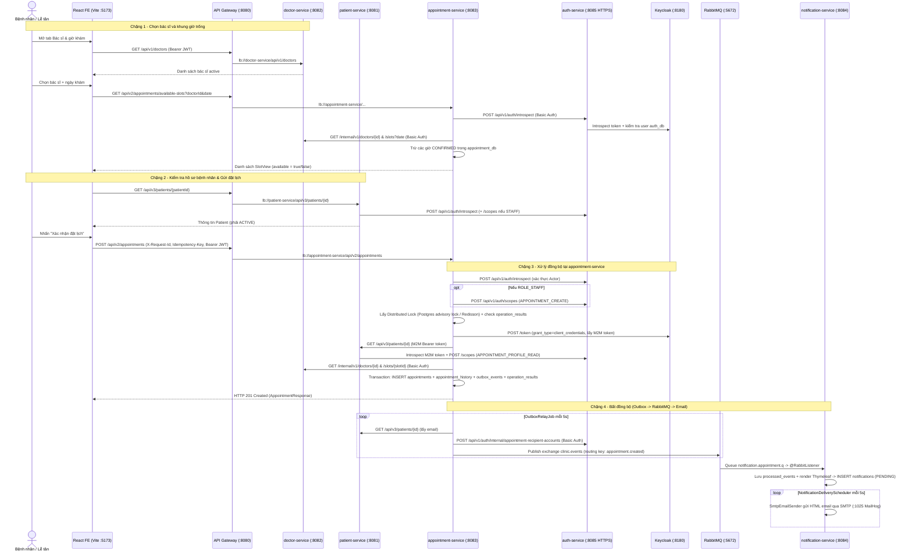

Canceled list repository files
Killed task List repository files
Ran list tracked files and root directories
Analyzed output.txt:L1-788
Analyzed output.txt:L1-788
Analyzed package.json:L1-34
Analyzed vite.config.js:L1-20
Analyzed App.jsx:L1-423
Analyzed BookingPage.jsx:L1-588
Analyzed Booking.jsx:L1-237
Analyzed api.js:L1-104
Analyzed api.js:L1-23
Analyzed session.js:L1-38
Analyzed DoctorDirectory.jsx:L1-331
Analyzed PatientSelection.jsx:L1-140
Analyzed ui.jsx:L1-162
Analyzed StaffWalkinPage.jsx:L1-12
Analyzed AuthContext.jsx:L1-143
Analyzed main.jsx:L1-10
Analyzed pom.xml:L1-126
Analyzed docker-compose.yml:L1-249
Analyzed pom.xml:L1-38
Analyzed application.yml:L1-26
Analyzed pom.xml:L1-47
Analyzed application.yml:L1-53
Analyzed ApiGatewayApplication.java:L1-14
Analyzed CorsConfig.java:L1-29
Analyzed .env.example:L1-137
Analyzed pom.xml:L1-24
Analyzed application.yml:L1-93
Analyzed .env.example:L1-42
Analyzed ApiResponse.java:L1-31
Analyzed ErrorCode.java:L1-27
Analyzed AppointmentBookedEvent.java:L1-64
Analyzed AppointmentServiceApplication.java:L1-14
Analyzed AppointmentController.java:L1-159
Analyzed BookAppointmentRequest.java:L1-13
Analyzed AppointmentRequestMapper.java:L1-20
Analyzed AppointmentAuthentication.java:L1-56
Analyzed AppointmentRequestIdFilter.java:L1-62
Analyzed AppointmentWebSecurityConfiguration.java:L1-16
Analyzed AppointmentConfig.java:L1-12
Analyzed AppointmentSettings.java:L1-39
Analyzed AppointmentSecuritySettings.java:L1-21
Analyzed ProviderCredentials.java:L1-15
Analyzed ProviderCredentialPolicy.java:L1-16
Analyzed RabbitMQConfig.java:L1-42
Analyzed RedisLockConfig.java:L1-44
Analyzed SchedulingConfig.java:L1-16
Analyzed AuthIdentityVerifier.java:L1-60
Analyzed AuthAppointmentScopeAdapter.java:L1-69
Analyzed AppointmentApplicationService.java:L1-95
Analyzed IdempotentAppointmentOperation.java:L1-58
Analyzed AppointmentPolicy.java:L1-60
Analyzed AppointmentSchedulingPolicy.java:L1-5
Analyzed Appointment.java:L1-238
Analyzed GetAvailableSlotsService.java:L1-58
Analyzed PublishOutboxService.java:L1-85
Analyzed AuthHttpTransport.java:L1-81
Analyzed HttpAppointmentReferenceAdapter.java:L1-212
Analyzed PatientServiceTokenProvider.java:L1-33
Analyzed ProviderHttp.java:L1-149
Analyzed ProviderTls.java:L1-29
Analyzed PostgresDistributedLockAdapter.java:L1-74
Analyzed RedissonDistributedLockAdapter.java:L1-34
Analyzed JpaAppointmentRepositoryAdapter.java:L1-125
Analyzed JdbcOperationResultAdapter.java:L1-68
Analyzed OutboxAppointmentEventPublisher.java:L1-75
Analyzed JdbcOutboxStoreAdapter.java:L1-122
Analyzed OutboxRelayJob.java:L1-27
Analyzed NotificationPayloadAdapter.java:L1-26
Analyzed RabbitNotificationPublisherAdapter.java:L1-44
Analyzed SpringTransactionAdapter.java:L1-29
Analyzed JdbcAppointmentHistoryAdapter.java:L1-62
Analyzed V1__appointment_v2.sql:L1-46
Analyzed pom.xml:L1-97
Analyzed application.yml:L1-131
Analyzed IntrospectionController.java:L1-87
Analyzed ScopeAuthorityController.java:L1-30
Analyzed AppointmentRecipientController.java:L1-36
Analyzed TokenVerificationService.java:L1-187
Analyzed ScopeAuthorityService.java:L1-83
Analyzed AppointmentRecipientService.java:L1-34
Analyzed SecurityConfig.java:L1-116
Analyzed KeycloakRestAdapter.java:L1-800
Analyzed pom.xml:L1-62
Analyzed application.yml:L1-46
Analyzed DoctorController.java:L1-91
Analyzed InternalDoctorController.java:L1-53
Analyzed DoctorReferenceFilter.java:L1-55
Analyzed DoctorApplicationService.java:L1-154
Analyzed pom.xml:L1-143
Analyzed application.yml:L1-62
Analyzed application-identity-introspection.yml:L1-16
Analyzed application-scope-authority.yml:L1-18
Analyzed PatientController.java:L1-79
Analyzed PatientApplicationService.java:L1-93
Analyzed PatientAuthentication.java:L1-31
Analyzed PatientPolicy.java:L1-81
Analyzed IntrospectionIdentityVerifier.java:L1-118
Analyzed RemoteWorkScopeAdapter.java:L1-76
Analyzed pom.xml:L1-99
Analyzed application.yml:L1-106
Analyzed RabbitMqConfig.java:L1-68
Analyzed AppointmentEventListener.java:L1-23
Analyzed NotificationIngestionService.java:L1-221
Analyzed NotificationDeliveryScheduler.java:L1-20
Analyzed NotificationDeliveryService.java:L1-66
Analyzed SmtpEmailSender.java:L1-48
Analyzed PatientWebConfiguration.java:L1-14
Analyzed PatientScopeConfiguration.java:L1-24
Analyzed Slot.java:L1-30
Analyzed V4__uuid_v4_identifiers.sql:L1-95
Analyzed AppointmentOperationResultCodec.java:L1-24
Analyzed AppointmentResponse.java:L1-50
Analyzed Start-FClinic.ps1:L1-152
Analyzed ConfiguredScopeAssignments.java:L1-25
Analyzed JpaAppointmentEntity.java:L1-67
Analyzed SpringDataJpaAppointmentRepository.java:L1-36
Analyzed JpaOutboxEventEntity.java:L1-75
Analyzed application-local.yml:L1-8
Analyzed PatientIdentityConfiguration.java:L1-19
Analyzed ThymeleafTemplateAdapter.java:L1-49
Analyzed authApi.js:L1-79
Analyzed ScopeAuthorityProperties.java:L1-32
Analyzed AppointmentBookedDomainEvent.java:L1-12
Analyzed fclinic-realm.json:L1-705
Analyzed V2__uuid_identifiers.sql:L1-72
Analyzed AppointmentNotificationEvent.java:L1-141
Analyzed AppointmentSnapshotDto.java:L1-20
Analyzed GlobalExceptionHandler.java:L1-81
Analyzed BookingCode.java:L1-23
Analyzed Recipient.java:L1-6
Analyzed ScopeAuthorityClient.java:L1-87
Analyzed JdbcOutboxStoreAdapter.java:L1-122
Analyzed IntrospectionDecoder.java:L1-106

Dưới đây là toàn bộ luồng đặt lịch khám từ **UI → FE → API Gateway → các Microservice → RabbitMQ/Email**, cùng với phần **cấu hình XML (`pom.xml`), YAML/Properties và bảo mật liên dịch vụ** dựa trên việc đọc mã nguồn hiện tại (không chỉnh sửa bất kỳ file nào).

---

### Sơ đồ tuần tự tổng thể (End-to-End Flow)

---

### 1. Cấu hình XML, Properties/YAML và Kiến trúc kết nối

#### A. Cấu hình Maven XML (`pom.xml`)
- **Root POM** [pom.xml](file:///c:/Fall%202026/MSS301/clinic-appointment-system/ClinicAppointmentBE/pom.xml): Định nghĩa Java 21, Spring Boot `4.1.1`, Spring Cloud `2025.1.3`, Redisson `3.35.0`, và 9 module con (`common-events`, `common-web`, `discovery-server`, `api-gateway`, `auth-service`, `patient-service`, `doctor-service`, `appointment-service`, `notification-service`).
- **Gateway XML** [api-gateway/pom.xml](file:///c:/Fall%202026/MSS301/clinic-appointment-system/ClinicAppointmentBE/infra/api-gateway/pom.xml): Dùng `spring-cloud-starter-gateway-server-webflux` (Netty reactive, không dùng Servlet `spring-boot-starter-web`) kết hợp `spring-cloud-starter-netflix-eureka-client`.
- **Service POMs**:
    - [appointment-service/pom.xml](file:///c:/Fall%202026/MSS301/clinic-appointment-system/ClinicAppointmentBE/services/appointment-service/pom.xml): `spring-boot-starter-webmvc`, `data-jpa`, `flyway` + `postgresql`, `spring-boot-starter-amqp` (RabbitMQ), `redisson` (`3.35.0`), `eureka-client`, `common-web`, `common-events`.
    - [auth-service/pom.xml](file:///c:/Fall%202026/MSS301/clinic-appointment-system/ClinicAppointmentBE/services/auth-service/pom.xml): Thêm `spring-boot-starter-security` + `oauth2-resource-server` + `mail`.
    - [doctor-service/pom.xml](file:///c:/Fall%202026/MSS301/clinic-appointment-system/ClinicAppointmentBE/services/doctor-service/pom.xml) & [patient-service/pom.xml](file:///c:/Fall%202026/MSS301/clinic-appointment-system/ClinicAppointmentBE/services/patient-service/pom.xml): Spring MVC + Data JPA + PostgreSQL + Eureka Client + `common-web`.
    - [notification-service/pom.xml](file:///c:/Fall%202026/MSS301/clinic-appointment-system/ClinicAppointmentBE/services/notification-service/pom.xml): `spring-boot-starter-amqp`, `thymeleaf`, `mail`, `flyway`, `oauth2-resource-server`.
- Lưu ý: Hệ thống **không dùng OpenFeign hay RestTemplate qua Eureka cho giao tiếp nội bộ**; Gateway dùng Eureka (`lb://...`), còn các service gọi nhau trực tiếp bằng **`java.net.http.HttpClient`** (và `RestClient` ở `auth-service` khi gọi Keycloak) với TLS/PKCS12 và deadline nghiêm ngặt.

#### B. Cấu hình Properties / YAML & Môi trường
Tất cả service đều nạp file `.env` qua dòng `spring.config.import` (ví dụ trong [appointment-service/application.yml](file:///c:/Fall%202026/MSS301/clinic-appointment-system/ClinicAppointmentBE/services/appointment-service/src/main/resources/application.yml#L4-L5)) và kết hợp với biến môi trường thiết lập bởi [Start-FClinic.ps1](file:///c:/Fall%202026/MSS301/clinic-appointment-system/docs/integration/Start-FClinic.ps1) + [ClinicAppointmentBE/.env.example](file:///c:/Fall%202026/MSS301/clinic-appointment-system/ClinicAppointmentBE/.env.example):

| Thành phần | File cấu hình chính | Các properties / cơ chế quan trọng |
|---|---|---|
| **Hạ tầng Docker** | [docker-compose.yml](file:///c:/Fall%202026/MSS301/clinic-appointment-system/ClinicAppointmentBE/docker-compose.yml) | Database-per-service PostgreSQL 16 (`5438` auth, `5439` keycloak, `5433` patient, `5434` doctor, `5435` appointment, `5436` notification), Keycloak (`8180`), Redis (`6379`), RabbitMQ (`5672`/`15672`), MailHog (`1025`/`8025`). |
| **Discovery Server** | [discovery-server/application.yml](file:///c:/Fall%202026/MSS301/clinic-appointment-system/ClinicAppointmentBE/infra/discovery-server/src/main/resources/application.yml) | Port `8761`, `register-with-eureka: false`, `fetch-registry: false`, tắt self-preservation để phát hiện service rớt nhanh. |
| **API Gateway** | [api-gateway/application.yml](file:///c:/Fall%202026/MSS301/clinic-appointment-system/ClinicAppointmentBE/infra/api-gateway/src/main/resources/application.yml) | Port `8080`. Định tuyến `lb://auth-service`, `lb://patient-service`, `lb://doctor-service`, `lb://appointment-service`, `lb://notification-service`. CORS cho `:5173` nằm ở [`CorsConfig`](file:///c:/Fall%202026/MSS301/clinic-appointment-system/ClinicAppointmentBE/infra/api-gateway/src/main/java/com/fclinic/apigateway/config/CorsConfig.java). |
| **Appointment Service** | [appointment-service/application.yml](file:///c:/Fall%202026/MSS301/clinic-appointment-system/ClinicAppointmentBE/services/appointment-service/src/main/resources/application.yml) | - `appointment.lock-provider: postgres` (hoặc `redis`). - `appointment.security.*` ([`AppointmentSecuritySettings`](file:///c:/Fall%202026/MSS301/clinic-appointment-system/ClinicAppointmentBE/services/appointment-service/src/main/java/com/fclinic/appointmentservice/config/AppointmentSecuritySettings.java)): URI & Basic credentials gọi `auth-service` (`introspection-uri`, `scope-uri`), client credentials gọi Keycloak lấy M2M token (`patient-token-uri`). - `appointment.providers.*` ([`ProviderCredentials`](file:///c:/Fall%202026/MSS301/clinic-appointment-system/ClinicAppointmentBE/services/appointment-service/src/main/java/com/fclinic/appointmentservice/config/ProviderCredentials.java)): Basic credentials riêng gọi `doctor-service` và endpoint recipient của `auth-service`. - `appointment.tls.trust-store` ([`ProviderTls`](file:///c:/Fall%202026/MSS301/clinic-appointment-system/ClinicAppointmentBE/services/appointment-service/src/main/java/com/fclinic/appointmentservice/infrastructure/ProviderTls.java)): file PKCS12 để tin cậy HTTPS của `auth-service`. - `spring.rabbitmq.*`: `publisher-confirm-type: correlated`, `publisher-returns: true`, `template.mandatory: true`. - `spring.jackson`: chặn `allow-coercion-of-scalars: false`, `fail-on-unknown-properties: true`. |
| **Auth Service** | [auth-service/application.yml](file:///c:/Fall%202026/MSS301/clinic-appointment-system/ClinicAppointmentBE/services/auth-service/src/main/resources/application.yml) | Port `8085` (khi chạy qua `Start-FClinic.ps1` bật SSL PKCS12 HTTPS). Khai báo `app.introspection.clients.*`, `app.authorization.clients.*`, `app.authorization.services.appointment` (`subject: 22222222-2222-4222-8222-222222222205`, `authorities: [SVC_PATIENT_READ]`), `app.authorization.grants` (cấp quyền `APPOINTMENT_PROFILE_READ` toàn cục cho `appointment-service`), `app.recipients.*`. |
| **Patient Service** | [patient-service/application.yml](file:///c:/Fall%202026/MSS301/clinic-appointment-system/ClinicAppointmentBE/services/patient-service/src/main/resources/application.yml) + profiles | Port `8081`. Chạy với profile `service-integration,doctor-reference` ([`application-identity-introspection.yml`](file:///c:/Fall%202026/MSS301/clinic-appointment-system/ClinicAppointmentBE/services/patient-service/src/main/resources/application-identity-introspection.yml), [`application-scope-authority.yml`](file:///c:/Fall%202026/MSS301/clinic-appointment-system/ClinicAppointmentBE/services/patient-service/src/main/resources/application-scope-authority.yml)). Ánh xạ `patient.identity.services.appointment.subject` thành `serviceName = "appointment-service"`. |
| **Doctor Service** | [doctor-service/application.yml](file:///c:/Fall%202026/MSS301/clinic-appointment-system/ClinicAppointmentBE/services/doctor-service/src/main/resources/application.yml) | Port `8082`. Cấu hình `doctor.references.appointment-client-id` và `appointment-client-secret` để bảo vệ `/internal/v1/doctors/**`. |
| **Notification Service** | [notification-service/application.yml](file:///c:/Fall%202026/MSS301/clinic-appointment-system/ClinicAppointmentBE/services/notification-service/src/main/resources/application.yml) | Port `8084`. `spring.flyway.placeholder-replacement: false` (tránh xung đột `${...}` trong seed template Thymeleaf), `spring.rabbitmq.listener.simple` (`prefetch: 20`, `retry` 3 lần, `default-requeue-rejected: false` để đẩy vào DLQ), `app.notification.delivery.scheduler-delay-ms: 5000`, `spring.mail.*` (`localhost:1025`). |

---

### 2. Trình tự luồng chạy chi tiết (UI → FE → Gateway → Services)

> **Lưu ý về mã nguồn FE:** File [BookingPage.jsx](file:///c:/Fall%202026/MSS301/clinic-appointment-system/ClinicAppointmentFE/src/pages/BookingPage.jsx) là màn hình cũ không còn được gắn vào [App.jsx](file:///c:/Fall%202026/MSS301/clinic-appointment-system/ClinicAppointmentFE/src/App.jsx) (và `appointmentApi.bookAppointment` trong [src/services/api.js](file:///c:/Fall%202026/MSS301/clinic-appointment-system/ClinicAppointmentFE/src/services/api.js#L5-L10) đã bị khóa thành `unsupported`). Luồng đặt lịch thực tế đang chạy nằm trong `ClinicAppointmentFE/src/appointment/`.

#### Bước 1: Điều hướng & chọn Bác sĩ + Khung giờ trống (UI → FE → Gateway → `doctor-service` & `appointment-service`)
1. **Tại UI (`App.jsx` & `DoctorDirectory.jsx`)**:
    - Với `ROLE_PATIENT` (đã có `user.patientId`) tab mặc định là `"doctors"` ([`getDefaultTab`](file:///c:/Fall%202026/MSS301/clinic-appointment-system/ClinicAppointmentFE/src/App.jsx#L134-L147)); với `ROLE_STAFF`, lễ tân chọn hồ sơ bệnh nhân ở [`StaffWalkinPage`](file:///c:/Fall%202026/MSS301/clinic-appointment-system/ClinicAppointmentFE/src/pages/StaffWalkinPage.jsx) trước rồi chuyển sang tab `"doctors"`.
    - [`DoctorDirectory`](file:///c:/Fall%202026/MSS301/clinic-appointment-system/ClinicAppointmentFE/src/appointment/DoctorDirectory.jsx#L190-L212) gọi [`doctorApi.list()`](file:///c:/Fall%202026/MSS301/clinic-appointment-system/ClinicAppointmentFE/src/appointment/api.js#L93) → `GET /api/v1/doctors`.
    - Khi người dùng chọn một bác sĩ và ngày khám, [`SlotGrid`](file:///c:/Fall%202026/MSS301/clinic-appointment-system/ClinicAppointmentFE/src/appointment/DoctorDirectory.jsx#L105-L180) gọi [`appointmentApi.available(doctorId, date)`](file:///c:/Fall%202026/MSS301/clinic-appointment-system/ClinicAppointmentFE/src/appointment/api.js#L81-L85) → `GET /api/v2/appointments/available-slots?doctorId=...&date=...`.
2. **Tại tầng FE Adapter (`src/appointment/api.js` & `vite.config.js`)**:
    - [vite.config.js](file:///c:/Fall%202026/MSS301/clinic-appointment-system/ClinicAppointmentFE/vite.config.js#L13-L16) proxy mọi đường dẫn `/api/*` sang API Gateway `http://localhost:8080`.
    - Interceptor của [`apiClient`](file:///c:/Fall%202026/MSS301/clinic-appointment-system/ClinicAppointmentFE/src/appointment/api.js#L22-L30) tự gắn `X-Request-Id: crypto.randomUUID()` và `Authorization: Bearer <fclinic_token>`. (Nếu API trả `401`, response interceptor tự gọi [`refreshSession`](file:///c:/Fall%202026/MSS301/clinic-appointment-system/ClinicAppointmentFE/src/services/session.js#L13-L38) tới `/api/v1/auth/refresh` rồi thử lại request).
3. **Tại API Gateway & Backend**:
    - `GET /api/v1/doctors` khớp route `doctor-service-route` → chuyển tới [`DoctorController.getDoctors`](file:///c:/Fall%202026/MSS301/clinic-appointment-system/ClinicAppointmentBE/services/doctor-service/src/main/java/com/fclinic/doctorservice/api/controller/DoctorController.java#L38-L46) → [`DoctorApplicationService.listDoctors`](file:///c:/Fall%202026/MSS301/clinic-appointment-system/ClinicAppointmentBE/services/doctor-service/src/main/java/com/fclinic/doctorservice/application/usecase/DoctorApplicationService.java#L56-L66) lấy bác sĩ đang `active` từ `doctor_db`.
    - `GET /api/v2/appointments/available-slots` khớp `appointment-service-route` → qua [`AppointmentAuthentication`](file:///c:/Fall%202026/MSS301/clinic-appointment-system/ClinicAppointmentBE/services/appointment-service/src/main/java/com/fclinic/appointmentservice/api/AppointmentAuthentication.java) (introspect token với `auth-service`) → [`AppointmentController.availableSlots`](file:///c:/Fall%202026/MSS301/clinic-appointment-system/ClinicAppointmentBE/services/appointment-service/src/main/java/com/fclinic/appointmentservice/api/controller/AppointmentController.java#L126-L132) → [`GetAvailableSlotsService.getAvailableSlots`](file:///c:/Fall%202026/MSS301/clinic-appointment-system/ClinicAppointmentBE/services/appointment-service/src/main/java/com/fclinic/appointmentservice/application/usecase/GetAvailableSlotsService.java#L31-L57):
        - Gọi nội bộ `doctor-service` (`/internal/v1/doctors/{doctorId}` và `/internal/v1/doctors/{doctorId}/slots?date=...`) bằng Basic Auth thông qua [`HttpAppointmentReferenceAdapter`](file:///c:/Fall%202026/MSS301/clinic-appointment-system/ClinicAppointmentBE/services/appointment-service/src/main/java/com/fclinic/appointmentservice/infrastructure/adapter/HttpAppointmentReferenceAdapter.java#L82-L164).
        - Lấy danh sách giờ đã có lịch `CONFIRMED` trong `appointment_db` qua `repository.occupied(doctorId, date)`.
        - Tính `available = !occupied.contains(s.start()) && thời_gian_bắt_đầu > now`.
4. **Chọn slot**: Người dùng nhấn vào 1 khung giờ → `onPick(selected, slot)` trong [`MainApp`](file:///c:/Fall%202026/MSS301/clinic-appointment-system/ClinicAppointmentFE/src/App.jsx#L366-L370) lưu `selection = { doctor, slot }` và chuyển sang tab `"booking"`.

---

#### Bước 2: Chuẩn bị hồ sơ bệnh nhân & Gửi yêu cầu đặt lịch ở FE (`Booking.jsx` → `ui.jsx` → `api.js`)
1. [`Booking`](file:///c:/Fall%202026/MSS301/clinic-appointment-system/ClinicAppointmentFE/src/appointment/Booking.jsx#L23-L237) render [`PatientSelection`](file:///c:/Fall%202026/MSS301/clinic-appointment-system/ClinicAppointmentFE/src/appointment/PatientSelection.jsx#L7-L140):
    - Khi có `patientId`, FE gọi `patientApi.get(patientId)` (`GET /api/v3/patients/{id}`) qua Gateway → `patient-service` ([`PatientController.get`](file:///c:/Fall%202026/MSS301/clinic-appointment-system/ClinicAppointmentBE/services/patient-service/src/main/java/com/fclinic/patientservice/api/controller/PatientController.java#L39-L41)). Nút đặt lịch chỉ mở khi `patient?.status === "ACTIVE"`.
2. Khi nhấn **"Xác nhận đặt lịch"**, hàm [`confirm`](file:///c:/Fall%202026/MSS301/clinic-appointment-system/ClinicAppointmentFE/src/appointment/Booking.jsx#L37-L49) tạo payload `{ patientId, doctorId, slotId, reasonForVisit }` và gọi [`useMutation.run`](file:///c:/Fall%202026/MSS301/clinic-appointment-system/ClinicAppointmentFE/src/appointment/ui.jsx#L107-L160):
    - Sinh `Idempotency-Key` UUID (`crypto.randomUUID()`) và lưu `{ key, payload }` vào `sessionStorage` (`fclinic.pending.<subject>.CREATE`). Nếu mạng rớt và user bấm thử lại, FE giữ nguyên `key` và `payload` này để tránh tạo trùng lịch.
    - Gọi [`appointmentApi.book(body, key)`](file:///c:/Fall%202026/MSS301/clinic-appointment-system/ClinicAppointmentFE/src/appointment/api.js#L86) → gửi `POST /api/v2/appointments` với header `Idempotency-Key`, `X-Request-Id`, `Authorization: Bearer <token>`.

---

#### Bước 3: Định tuyến tại API Gateway (`api-gateway`)
- Request `POST /api/v2/appointments` vào cổng `8080`:
    - [`CorsConfig.corsWebFilter`](file:///c:/Fall%202026/MSS301/clinic-appointment-system/ClinicAppointmentBE/infra/api-gateway/src/main/java/com/fclinic/apigateway/config/CorsConfig.java#L16-L28) xử lý CORS cho origin `http://localhost:5173` / `http://127.0.0.1:5173`.
    - Predicate `Path=/api/v2/appointments/**` khớp `appointment-service-route` trong [api-gateway/application.yml](file:///c:/Fall%202026/MSS301/clinic-appointment-system/ClinicAppointmentBE/infra/api-gateway/src/main/resources/application.yml#L26-L29), tra cứu danh sách instance `appointment-service` từ Eureka (`discovery-server`) qua `lb://appointment-service` và forward HTTP request kèm đầy đủ headers.

---

#### Bước 4: Chuỗi xử lý đồng bộ trong `appointment-service` & gọi chéo các service khác

##### 4.1. Filter & Xác thực người gọi (Interceptor → `auth-service` → Keycloak)
1. [`AppointmentRequestIdFilter.doFilterInternal`](file:///c:/Fall%202026/MSS301/clinic-appointment-system/ClinicAppointmentBE/services/appointment-service/src/main/java/com/fclinic/appointmentservice/api/AppointmentRequestIdFilter.java#L22-L61):
    - Validate `X-Request-Id` phải là UUID hợp lệ (nếu không gửi thì tự tạo mới, nếu sai format trả `400 VALIDATION_ERROR`), set `Cache-Control: no-store`. (Các đường dẫn `/api/v1/appointments/**` bị chặn ngay tại đây với mã `410`).
2. [`AppointmentAuthentication.preHandle`](file:///c:/Fall%202026/MSS301/clinic-appointment-system/ClinicAppointmentBE/services/appointment-service/src/main/java/com/fclinic/appointmentservice/api/AppointmentAuthentication.java#L22-L38) (cấu hình trong [`AppointmentWebSecurityConfiguration`](file:///c:/Fall%202026/MSS301/clinic-appointment-system/ClinicAppointmentBE/services/appointment-service/src/main/java/com/fclinic/appointmentservice/config/AppointmentWebSecurityConfiguration.java)):
    - Đặt deadline 5 giây cho toàn request.
    - Gọi [`AuthIdentityVerifier.verify`](file:///c:/Fall%202026/MSS301/clinic-appointment-system/ClinicAppointmentBE/services/appointment-service/src/main/java/com/fclinic/appointmentservice/infrastructure/security/AuthIdentityVerifier.java#L20-L50) → dùng [`AuthHttpTransport.post`](file:///c:/Fall%202026/MSS301/clinic-appointment-system/ClinicAppointmentBE/services/appointment-service/src/main/java/com/fclinic/appointmentservice/infrastructure/security/AuthHttpTransport.java#L34-L61) gửi `POST https://localhost:8085/api/v1/auth/introspect` (Basic Auth `appointment-introspection`, form `token=...&token_type_hint=access_token`).
3. Bên `auth-service`:
    - [`SecurityConfig.publicTokenInspectionFilterChain`](file:///c:/Fall%202026/MSS301/clinic-appointment-system/ClinicAppointmentBE/services/auth-service/src/main/java/com/fclinic/authservice/infrastructure/config/SecurityConfig.java#L41-L50) cho phép đi vào [`IntrospectionController.introspect`](file:///c:/Fall%202026/MSS301/clinic-appointment-system/ClinicAppointmentBE/services/auth-service/src/main/java/com/fclinic/authservice/api/controller/IntrospectionController.java#L52-L78), tự kiểm tra Basic Auth client credentials.
    - [`TokenVerificationService.introspect`](file:///c:/Fall%202026/MSS301/clinic-appointment-system/ClinicAppointmentBE/services/auth-service/src/main/java/com/fclinic/authservice/application/service/TokenVerificationService.java#L77-L134) gọi [`KeycloakRestAdapter.introspectToken`](file:///c:/Fall%202026/MSS301/clinic-appointment-system/ClinicAppointmentBE/services/auth-service/src/main/java/com/fclinic/authservice/infrastructure/adapter/KeycloakRestAdapter.java#L265-L333) tới Keycloak, kiểm tra user active trong `auth_db` (`userRepository.findByKeycloakId`), trả về JSON theo contract `patient-identity-introspection/2` (11 trường gồm `sub`, `userId`, `patientId`, `doctorId`, `authorities`, `principalType`, `aud`, `iss`, `exp`...).
4. `AuthIdentityVerifier` kiểm tra `principalType == "USER"` (từ chối token dịch vụ gọi API người dùng), khớp `iss`, `aud` chứa `"appointment-service"`, chưa hết hạn → gắn `AppointmentActor` vào request attribute `"appointmentActor"`.

##### 4.2. Controller, Phân quyền (Policy & Work Scope)
1. [`AppointmentController.bookAppointment`](file:///c:/Fall%202026/MSS301/clinic-appointment-system/ClinicAppointmentBE/services/appointment-service/src/main/java/com/fclinic/appointmentservice/api/controller/AppointmentController.java#L51-L65) parse `Idempotency-Key` qua [`AppointmentRequestMapper.key`](file:///c:/Fall%202026/MSS301/clinic-appointment-system/ClinicAppointmentBE/services/appointment-service/src/main/java/com/fclinic/appointmentservice/api/mapper/AppointmentRequestMapper.java#L9-L19) và gọi [`AppointmentApplicationService.bookAppointment`](file:///c:/Fall%202026/MSS301/clinic-appointment-system/ClinicAppointmentBE/services/appointment-service/src/main/java/com/fclinic/appointmentservice/application/usecase/AppointmentApplicationService.java#L50-L94).
2. Kiểm tra quyền tại [`AppointmentPolicy.mutate`](file:///c:/Fall%202026/MSS301/clinic-appointment-system/ClinicAppointmentBE/services/appointment-service/src/main/java/com/fclinic/appointmentservice/application/security/AppointmentPolicy.java#L22-L26):
    - Nếu là **`ROLE_PATIENT`**: `command.patientId()` bắt buộc phải trùng `actor.patientId()`.
    - Nếu là **`ROLE_STAFF`**: gọi [`AuthAppointmentScopeAdapter.allowed`](file:///c:/Fall%202026/MSS301/clinic-appointment-system/ClinicAppointmentBE/services/appointment-service/src/main/java/com/fclinic/appointmentservice/infrastructure/security/AuthAppointmentScopeAdapter.java#L21-L67) → gửi `POST https://localhost:8085/api/v1/auth/scopes` (Basic Auth `appointment-scope`, contract `appointment-work-scope/1`, `operation: "APPOINTMENT_CREATE"`) tới [`ScopeAuthorityController`](file:///c:/Fall%202026/MSS301/clinic-appointment-system/ClinicAppointmentBE/services/auth-service/src/main/java/com/fclinic/authservice/api/controller/ScopeAuthorityController.java) → [`ScopeAuthorityService.evaluate`](file:///c:/Fall%202026/MSS301/clinic-appointment-system/ClinicAppointmentBE/services/auth-service/src/main/java/com/fclinic/appointmentservice/infrastructure/security/AuthAppointmentScopeAdapter.java) kiểm tra grant được cấu hình trong `app.authorization.grants`.

##### 4.3. Distributed Lock & Idempotency
[`IdempotentAppointmentOperation.execute`](file:///c:/Fall%202026/MSS301/clinic-appointment-system/ClinicAppointmentBE/services/appointment-service/src/main/java/com/fclinic/appointmentservice/application/usecase/IdempotentAppointmentOperation.java#L26-L46):
1. Tính SHA-256 `requestHash` qua [`JdbcOperationResultAdapter.fingerprint`](file:///c:/Fall%202026/MSS301/clinic-appointment-system/ClinicAppointmentBE/services/appointment-service/src/main/java/com/fclinic/appointmentservice/infrastructure/adapter/JdbcOperationResultAdapter.java#L53-L67) từ `"POST /api/v2/appointments"` và canonical `TreeMap` body (`patientId`, `doctorId`, `slotId`, `reasonForVisit`).
2. Xin khóa phân tán theo key `<subject>\nCREATE\n<idempotencyKey>`:
    - Mặc định (`appointment.lock-provider: postgres`): [`PostgresDistributedLockAdapter`](file:///c:/Fall%202026/MSS301/clinic-appointment-system/ClinicAppointmentBE/services/appointment-service/src/main/java/com/fclinic/appointmentservice/infrastructure/adapter/PostgresDistributedLockAdapter.java#L38-L73) mở kết nối JDBC riêng (ngoài Hikari pool) chạy `SELECT pg_try_advisory_lock(?)` (non-blocking) và `pg_advisory_unlock(?)` ở `finally`.
    - Nếu cấu hình `appointment.lock-provider: redis`: [`RedissonDistributedLockAdapter`](file:///c:/Fall%202026/MSS301/clinic-appointment-system/ClinicAppointmentBE/services/appointment-service/src/main/java/com/fclinic/appointmentservice/infrastructure/adapter/RedissonDistributedLockAdapter.java) dùng `RedissonClient.getLock("appointment:operation:" + key).tryLock()`.
    - Nếu trùng request đang chạy song song → trả `409 OPERATION_IN_PROGRESS`.
3. Kiểm tra bảng `operation_results`: nếu khóa đã tồn tại và `requestHash` khớp → trả về ngay kết quả cũ (không tạo lịch mới); nếu `requestHash` khác → trả `409 IDEMPOTENCY_CONFLICT`.

##### 4.4. Gọi chéo `patient-service` và `doctor-service` (trước khi mở DB transaction)
Để tránh giữ DB connection/lock trong lúc gọi mạng:
1. **Xác minh Patient (`appointment-service` → Keycloak → `patient-service` → `auth-service`)**:
    - [`PatientServiceTokenProvider.token`](file:///c:/Fall%202026/MSS301/clinic-appointment-system/ClinicAppointmentBE/services/appointment-service/src/main/java/com/fclinic/appointmentservice/infrastructure/security/PatientServiceTokenProvider.java#L19-L32) gọi Keycloak (`POST /realms/fclinic/protocol/openid-connect/token`, `grant_type=client_credentials`, client `appointment-service`) để lấy **M2M token** (có cache nội bộ, **không bao giờ forward Bearer token của trình duyệt**).
    - [`HttpAppointmentReferenceAdapter.patient`](file:///c:/Fall%202026/MSS301/clinic-appointment-system/ClinicAppointmentBE/services/appointment-service/src/main/java/com/fclinic/appointmentservice/infrastructure/adapter/HttpAppointmentReferenceAdapter.java#L35-L80) gọi `GET http://localhost:8081/api/v3/patients/{patientId}` kèm M2M Bearer token.
    - Bên `patient-service`:
        - [`PatientAuthentication`](file:///c:/Fall%202026/MSS301/clinic-appointment-system/ClinicAppointmentBE/services/patient-service/src/main/java/com/fclinic/patientservice/api/security/PatientAuthentication.java) → [`IntrospectionIdentityVerifier`](file:///c:/Fall%202026/MSS301/clinic-appointment-system/ClinicAppointmentBE/services/patient-service/src/main/java/com/fclinic/patientservice/infrastructure/adapter/identity/IntrospectionIdentityVerifier.java) gọi `auth-service` `/api/v1/auth/introspect` (Basic Auth `patient-service`). [`IntrospectionDecoder`](file:///c:/Fall%202026/MSS301/clinic-appointment-system/ClinicAppointmentBE/services/patient-service/src/main/java/com/fclinic/patientservice/infrastructure/adapter/identity/IntrospectionDecoder.java#L60-L66) đối chiếu `sub` với `patient.identity.services.appointment.subject` để định danh `PrincipalType.SERVICE`, `serviceName = "appointment-service"`, quyền `SVC_PATIENT_READ`.
        - [`PatientPolicy.readProfile`](file:///c:/Fall%202026/MSS301/clinic-appointment-system/ClinicAppointmentBE/services/patient-service/src/main/java/com/fclinic/patientservice/application/security/PatientPolicy.java#L39-L40) gọi [`RemoteWorkScopeAdapter.appointmentProfileLookup`](file:///c:/Fall%202026/MSS301/clinic-appointment-system/ClinicAppointmentBE/services/patient-service/src/main/java/com/fclinic/patientservice/infrastructure/adapter/scope/RemoteWorkScopeAdapter.java#L47-L51) → [`ScopeAuthorityClient`](file:///c:/Fall%202026/MSS301/clinic-appointment-system/ClinicAppointmentBE/services/patient-service/src/main/java/com/fclinic/patientservice/infrastructure/adapter/scope/ScopeAuthorityClient.java) gọi `auth-service` `/api/v1/auth/scopes` (`patient-work-scope/2`, `APPOINTMENT_PROFILE_READ`).
        - Trả về thông tin bệnh nhân (`fullName`, `phoneNumber`, `status`). `appointment-service` kiểm tra bắt buộc `status == "ACTIVE"`.
2. **Xác minh Doctor & Slot (`appointment-service` → `doctor-service`)**:
    - [`HttpAppointmentReferenceAdapter.doctor`](file:///c:/Fall%202026/MSS301/clinic-appointment-system/ClinicAppointmentBE/services/appointment-service/src/main/java/com/fclinic/appointmentservice/infrastructure/adapter/HttpAppointmentReferenceAdapter.java#L82-L120) & [`slot`](file:///c:/Fall%202026/MSS301/clinic-appointment-system/ClinicAppointmentBE/services/appointment-service/src/main/java/com/fclinic/appointmentservice/infrastructure/adapter/HttpAppointmentReferenceAdapter.java#L122-L140) gọi `GET http://localhost:8082/internal/v1/doctors/{doctorId}` và `/internal/v1/doctors/{doctorId}/slots/{slotId}` dùng **Basic Auth** (`appointment-doctor-reference`).
    - Bên `doctor-service`, [`DoctorReferenceFilter`](file:///c:/Fall%202026/MSS301/clinic-appointment-system/ClinicAppointmentBE/services/doctor-service/src/main/java/com/fclinic/doctorservice/api/DoctorReferenceFilter.java) xác thực Basic Auth và trả kèm header `X-FClinic-Reference-Contract: appointment-doctor-reference/1` từ [`InternalDoctorController`](file:///c:/Fall%202026/MSS301/clinic-appointment-system/ClinicAppointmentBE/services/doctor-service/src/main/java/com/fclinic/doctorservice/api/controller/InternalDoctorController.java).
    - `appointment-service` kiểm tra `doctor.active == true`, lấy `consultationFee`, và gọi [`Slot.requireBookable`](file:///c:/Fall%202026/MSS301/clinic-appointment-system/ClinicAppointmentBE/services/appointment-service/src/main/java/com/fclinic/appointmentservice/domain/Slot.java#L23-L29) kiểm tra slot đã `published`, đúng bác sĩ, dài tròn 60 phút, và thời gian bắt đầu (múi giờ `Asia/Saigon`) ở tương lai.

##### 4.5. Ghi ACID Transaction vào `appointment_db`
[`SpringTransactionAdapter.execute`](file:///c:/Fall%202026/MSS301/clinic-appointment-system/ClinicAppointmentBE/services/appointment-service/src/main/java/com/fclinic/appointmentservice/infrastructure/adapter/SpringTransactionAdapter.java) (transaction timeout 5s) thực hiện đồng thời 4 thao tác ghi trong 1 transaction:
1. [`Appointment.createNew`](file:///c:/Fall%202026/MSS301/clinic-appointment-system/ClinicAppointmentBE/services/appointment-service/src/main/java/com/fclinic/appointmentservice/domain/aggregate/Appointment.java#L72-L104) + [`JpaAppointmentRepositoryAdapter.save`](file:///c:/Fall%202026/MSS301/clinic-appointment-system/ClinicAppointmentBE/services/appointment-service/src/main/java/com/fclinic/appointmentservice/infrastructure/adapter/JpaAppointmentRepositoryAdapter.java#L27-L55): Sinh `bookingCode` (`FC-...`), `status = CONFIRMED`, lưu vào bảng `appointments`. Nếu hai người đặt trùng cùng bác sĩ/ngày/giờ ở trạng thái `CONFIRMED`, unique index [`uq_confirmed_doctor_hour`](file:///c:/Fall%202026/MSS301/clinic-appointment-system/ClinicAppointmentBE/services/appointment-service/src/main/resources/db/migration/V1__appointment_v2.sql#L14) trong PostgreSQL sẽ chặn và `SpringTransactionAdapter` dịch thành [`SlotAlreadyBookedException`](file:///c:/Fall%202026/MSS301/clinic-appointment-system/ClinicAppointmentBE/services/appointment-service/src/main/java/com/fclinic/appointmentservice/application/exception/SlotAlreadyBookedException.java) (`409`).
2. [`JdbcAppointmentHistoryAdapter.record`](file:///c:/Fall%202026/MSS301/clinic-appointment-system/ClinicAppointmentBE/services/appointment-service/src/main/java/com/fclinic/appointmentservice/infrastructure/adapter/JdbcAppointmentHistoryAdapter.java#L20-L43): Ghi audit log `"CREATED"` vào bảng `appointment_history`.
3. [`OutboxAppointmentEventPublisher.publish`](file:///c:/Fall%202026/MSS301/clinic-appointment-system/ClinicAppointmentBE/services/appointment-service/src/main/java/com/fclinic/appointmentservice/infrastructure/adapter/OutboxAppointmentEventPublisher.java#L27-L70): Ghi bản ghi sự kiện `APPOINTMENT_CREATED` (`schemaVersion: 3`, trạng thái `PENDING_ENRICHMENT`, **lược bỏ `reasonForVisit`** theo check constraint của DB) vào bảng `outbox_events`.
4. [`IdempotentAppointmentOperation.complete`](file:///c:/Fall%202026/MSS301/clinic-appointment-system/ClinicAppointmentBE/services/appointment-service/src/main/java/com/fclinic/appointmentservice/application/usecase/IdempotentAppointmentOperation.java#L48-L53): Dùng [`AppointmentOperationResultCodec`](file:///c:/Fall%202026/MSS301/clinic-appointment-system/ClinicAppointmentBE/services/appointment-service/src/main/java/com/fclinic/appointmentservice/api/mapper/AppointmentOperationResultCodec.java) đóng gói JSON HTTP `201` và lưu vào bảng `operation_results`.

Sau khi commit, trả `201 Created` về FE → `Booking.jsx` hiển thị màn hình xác nhận kèm mã đặt hẹn `FC-...`.

---

#### Bước 5: Luồng Bất đồng bộ (Transactional Outbox → RabbitMQ → `notification-service` → Email)
1. **Outbox Relay (`appointment-service`)**:
    - [`OutboxRelayJob.relay`](file:///c:/Fall%202026/MSS301/clinic-appointment-system/ClinicAppointmentBE/services/appointment-service/src/main/java/com/fclinic/appointmentservice/infrastructure/adapter/OutboxRelayJob.java#L18-L21) chạy mỗi `5s` → [`PublishOutboxService.publishPendingEvents`](file:///c:/Fall%202026/MSS301/clinic-appointment-system/ClinicAppointmentBE/services/appointment-service/src/main/java/com/fclinic/appointmentservice/application/usecase/PublishOutboxService.java#L42-L69):
    - [`JdbcOutboxStoreAdapter.claim`](file:///c:/Fall%202026/MSS301/clinic-appointment-system/ClinicAppointmentBE/services/appointment-service/src/main/java/com/fclinic/appointmentservice/infrastructure/adapter/JdbcOutboxStoreAdapter.java#L40-L66) dùng `FOR UPDATE SKIP LOCKED` lấy từng row.
    - [`NotificationPayloadAdapter.resolvePayload`](file:///c:/Fall%202026/MSS301/clinic-appointment-system/ClinicAppointmentBE/services/appointment-service/src/main/java/com/fclinic/appointmentservice/infrastructure/adapter/NotificationPayloadAdapter.java) gọi [`HttpAppointmentReferenceAdapter.recipients`](file:///c:/Fall%202026/MSS301/clinic-appointment-system/ClinicAppointmentBE/services/appointment-service/src/main/java/com/fclinic/appointmentservice/infrastructure/adapter/HttpAppointmentReferenceAdapter.java#L183-L204):
        - Gọi `patient-service` (`GET /api/v3/patients/{id}`) để lấy email/tên bệnh nhân.
        - Gọi `auth-service` (`POST https://localhost:8085/api/v1/auth/internal/appointment-recipient-accounts` với Basic Auth `appointment-recipient-accounts`) → [`AppointmentRecipientController`](file:///c:/Fall%202026/MSS301/clinic-appointment-system/ClinicAppointmentBE/services/auth-service/src/main/java/com/fclinic/authservice/api/controller/AppointmentRecipientController.java) → [`AppointmentRecipientService`](file:///c:/Fall%202026/MSS301/clinic-appointment-system/ClinicAppointmentBE/services/auth-service/src/main/java/com/fclinic/authservice/application/service/AppointmentRecipientService.java) để lấy `patientUserId` (nullable nếu walk-in) và `userId/name/email` của bác sĩ.
        - Gắn trường `recipients` vào JSON payload và chuyển trạng thái outbox sang `READY`.
    - [`RabbitNotificationPublisherAdapter.publish`](file:///c:/Fall%202026/MSS301/clinic-appointment-system/ClinicAppointmentBE/services/appointment-service/src/main/java/com/fclinic/appointmentservice/infrastructure/adapter/RabbitNotificationPublisherAdapter.java#L20-L43) gửi message `PERSISTENT` vào Topic Exchange **`clinic.events`** với routing key **`appointment.created`** và chờ Publisher Confirm ACK từ broker trong 5s rồi chuyển row sang `PUBLISHED`.
2. **Tiếp nhận & Gửi Email (`notification-service`)**:
    - [`RabbitMqConfig`](file:///c:/Fall%202026/MSS301/clinic-appointment-system/ClinicAppointmentBE/services/notification-service/src/main/java/com/fclinic/notificationservice/config/RabbitMqConfig.java) bind queue **`notification.appointment.q`** vào `clinic.events` với routing key `appointment.created` (kèm dead-letter `clinic.dlx` → `notification.appointment.dlq`).
    - **Phase A (Ingest)**: [`AppointmentEventListener.consume`](file:///c:/Fall%202026/MSS301/clinic-appointment-system/ClinicAppointmentBE/services/notification-service/src/main/java/com/fclinic/notificationservice/infrastructure/messaging/AppointmentEventListener.java) nhận [`AppointmentNotificationEvent`](file:///c:/Fall%202026/MSS301/clinic-appointment-system/ClinicAppointmentBE/services/notification-service/src/main/java/com/fclinic/notificationservice/application/dto/event/AppointmentNotificationEvent.java) → [`NotificationIngestionService.ingest`](file:///c:/Fall%202026/MSS301/clinic-appointment-system/ClinicAppointmentBE/services/notification-service/src/main/java/com/fclinic/notificationservice/application/usecase/NotificationIngestionService.java#L67-L139) kiểm tra chống trùng qua `processed_events` (`eventId`), render tiêu đề + nội dung HTML bằng [`ThymeleafTemplateAdapter`](file:///c:/Fall%202026/MSS301/clinic-appointment-system/ClinicAppointmentBE/services/notification-service/src/main/java/com/fclinic/notificationservice/infrastructure/adapter/ThymeleafTemplateAdapter.java) từ template DB, và lưu tối đa 2 bản ghi `PENDING` (cho bệnh nhân & bác sĩ) vào bảng `notifications` trong `notification_db`.
    - **Phase B (Delivery)**: [`NotificationDeliveryScheduler`](file:///c:/Fall%202026/MSS301/clinic-appointment-system/ClinicAppointmentBE/services/notification-service/src/main/java/com/fclinic/notificationservice/infrastructure/scheduler/NotificationDeliveryScheduler.java) chạy mỗi `5s` → [`NotificationDeliveryService.deliver`](file:///c:/Fall%202026/MSS301/clinic-appointment-system/ClinicAppointmentBE/services/notification-service/src/main/java/com/fclinic/notificationservice/application/usecase/NotificationDeliveryService.java#L39-L60) claim bản ghi → [`SmtpEmailSender.sendHtml`](file:///c:/Fall%202026/MSS301/clinic-appointment-system/ClinicAppointmentBE/services/notification-service/src/main/java/com/fclinic/notificationservice/infrastructure/mail/SmtpEmailSender.java) gửi HTML email qua `JavaMailSender` tới MailHog (`localhost:1025`) và cập nhật trạng thái `SENT` (hoặc lên lịch retry `1m` / `5m` nếu lỗi SMTP).