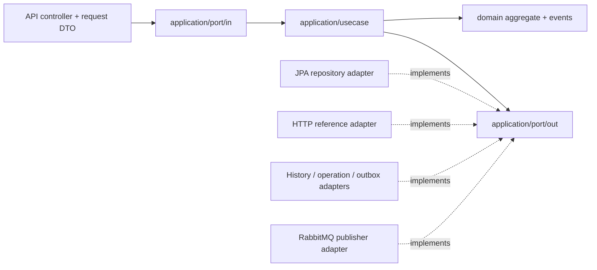

# 08 — Cấu trúc use case giữ theo bản pull

Giữ đủ **37 file Java gốc** và package/controller/command/port/domain/JPA adapter của bản pull. [Danh sách file gốc và base commit](contracts/preserved-appointment-source-paths.json). Nội dung/type được cập nhật theo Report; không phục hồi logic cũ nhận client snapshots, Patient Long, seed30phút hoặc cancellation không version.

## Luồng dependency

Controller chỉ map DTO → command/query và gọi input port. Application trả typed view hoặc operation result; API map response/serialize wrapper. Không import API DTO, JDBC/JPA, HTTP client, Jackson hoặc RabbitTemplate trong application. Domain không phụ thuộc Spring/JPA/API. Không có AppointmentService/AppointmentStore gom toàn bộ luồng như bản sửa trước.

## Use case và implementation

| Input port | Lớp xử lý trong application/usecase | Trách nhiệm |
| --- | --- | --- |
| BookAppointmentUseCase | [AppointmentApplicationService](../../src/main/java/com/fclinic/appointmentservice/application/usecase/AppointmentApplicationService.java) | Giữ tên file gốc, triển khai riêng booking; reference trước transaction, snapshot từ provider |
| CancelAppointmentUseCase | [CancelAppointmentService](../../src/main/java/com/fclinic/appointmentservice/application/usecase/CancelAppointmentService.java) | Lock current/version/future, cancel, history/event/result atomic |
| RescheduleAppointmentUseCase | [RescheduleAppointmentService](../../src/main/java/com/fclinic/appointmentservice/application/usecase/RescheduleAppointmentService.java) | Same doctor, slot mới, giữ snapshot và rollback khi trùng giờ |
| GetAppointmentUseCase | [GetAppointmentService](../../src/main/java/com/fclinic/appointmentservice/application/usecase/GetAppointmentService.java) | Đọc một lịch |
| ListAppointmentsUseCase | [ListAppointmentsService](../../src/main/java/com/fclinic/appointmentservice/application/usecase/ListAppointmentsService.java) | Validation/filter/page |
| GetAvailableSlotsUseCase | [GetAvailableSlotsService](../../src/main/java/com/fclinic/appointmentservice/application/usecase/GetAvailableSlotsService.java) | Doctor offers + Appointment occupancy overlay |
| GetAppointmentHistoryUseCase | [GetAppointmentHistoryService](../../src/main/java/com/fclinic/appointmentservice/application/usecase/GetAppointmentHistoryService.java) | History của lịch tồn tại |
| GetAppointmentReferenceUseCase | [GetAppointmentReferenceService](../../src/main/java/com/fclinic/appointmentservice/application/usecase/GetAppointmentReferenceService.java) | Hai minimum projections cho consumer |
| GenerateAppointmentRemindersUseCase | [GenerateAppointmentRemindersService](../../src/main/java/com/fclinic/appointmentservice/application/usecase/GenerateAppointmentRemindersService.java) | Due/version/status + unique reminder |
| PublishOutboxUseCase | [PublishOutboxService](../../src/main/java/com/fclinic/appointmentservice/application/usecase/PublishOutboxService.java) | Claim/enrich/freeze/publish/confirm/retry/suppress |

[IdempotentAppointmentOperation](../../src/main/java/com/fclinic/appointmentservice/application/usecase/IdempotentAppointmentOperation.java) chỉ chia sẻ cơ chế key/hash/replay/committed result cho ba mutation; không chứa logic đặt/hủy/đổi lịch. Mỗi use case tự mở local write unit of work sau remote reference validation.

## Giữ adapter/config gốc

- [JpaAppointmentRepositoryAdapter](../../src/main/java/com/fclinic/appointmentservice/infrastructure/adapter/JpaAppointmentRepositoryAdapter.java) thực sự dùng SpringDataJpaAppointmentRepository/JpaAppointmentEntity; UUID Patient và @Version. Aggregate nghiệp vụ ở domain/aggregate/Appointment, status ở domain/model/AppointmentStatus, BookingCode ở domain/vo.
- [OutboxAppointmentEventPublisher](../../src/main/java/com/fclinic/appointmentservice/infrastructure/adapter/OutboxAppointmentEventPublisher.java) thực sự persist JpaOutboxEventEntity qua SpringDataJpaOutboxEventRepository trong transaction hiện có. Domain events giữ tên Booked/Cancelled, bổ sung Rescheduled/Reminder, snapshot không có clinical reason/fee.
- [OutboxRelayJob](../../src/main/java/com/fclinic/appointmentservice/infrastructure/adapter/OutboxRelayJob.java) chỉ là scheduled inbound adapter, gọi hai use case publish/reminder; RabbitTemplate nằm riêng trong infrastructure adapter.
- Giữ RabbitMQConfig, RedisLockConfig, SchedulingConfig. RedissonDistributedLockAdapter là implementation có thật, bật bằng APPOINTMENT_LOCK_PROVIDER=redis; mặc định postgres dùng session advisory guard cho idempotency. Guard trả ngay khi key đang xử lý. Dù chọn loại nào, PostgreSQL unique doctor/date/start CONFIRMED vẫn là capacity authority, không dùng slotId hay Redis làm ràng buộc cuối.
- OutboxEventController/OutboxEventResponse gốc được giữ để tương thích cấu trúc; v1 monitor được retire410, không mở API xem intent/payload mới.

## Atomic local transaction

[UnitOfWorkPort](../../src/main/java/com/fclinic/appointmentservice/application/port/out/UnitOfWorkPort.java) → SpringTransactionAdapter → TransactionTemplate dùng JpaTransactionManager. JPA aggregate/outbox và JDBC history/operation_results/reminder claims dùng **cùng datasource và local transaction connection**. SQL/history/result/outbox lỗi phải rollback aggregate; không gọi HTTP/RabbitMQ trong write transaction.

Postgres idempotency advisory guard dùng connection riêng, không bind pre-existing JDBC ConnectionHolder vào JpaTransactionManager và không giữ chỗ trong cùng pool của JPA khi chờ provider. Redis implementation giữ khóa đến khi work kết thúc, không cache kết quả thay operation_results. Khóa được release khi request kết thúc; database vẫn quyết định tính đúng đắn sau rollback/restart.

Các kiểu API giữ theo Report và OpenAPI bàn giao. Việc tách use case không thay contract FE/provider, không thêm security, không sửa source service khác.
